# Garnet’s Ocean — Country Roots

Mijn digital garden over countrymuziek, met Houston, Texas als persoonlijk startpunt. De website bevat een saloon-startscherm, een homepage en de doorlopende Story-pagina **Country Roots** met een interactieve gitaartijdlijn, muzikale wortels en een artiestenverzameling. De bronnenpagina verzamelt beeldmateriaal, onderzoek en videolinks. De privacypagina geeft uitleg over opslag en externe diensten en bevat een demonstratieformulier in de vorm van een vintage ansichtkaart.

Daarnaast bevat de repository een zelfstandige typografieopdracht over *Y.M.C.A.* van Village People. Die heeft een eigen vormgeving en gebruikt alleen HTML, CSS en het variabele lettertype SeraphsVF.

Dit project is begonnen als fork van de modelrepository voor 'Het web is voor iedereen'.

Website: [garnetsocean.nl](https://garnetsocean.nl)

## Inhoud

- [Learning log](#learning-log)
  - [Checkouts](#checkouts)
  - [Weekoverzicht](#weekoverzicht)
  - [Feedback in trio’s](#feedbacktrios)
- [Creatief proces en ontwerpkeuzes](#creatief-proces-en-ontwerpkeuzes)
- [Retrospectives](#retrospectives)
- [Bronnen](#bronnen)

---

## Learning log

### Kickoff — 31 augustus 2026

Een fork van de model repository gemaakt en gepubliceerd via mijn eigen Github omgeving.

### Checkouts

Klik hier om alle checkouts te lezen

#### Checkout - 31-08-2026
1. Een source hosting platform is een platform waarop jouw source code kan worden behouden/beheerd. Ik heb gekozen voor Github omdat ik daar het meest bekend mee ben.
2. Ik heb mijn gamerTag Garnet Oceans gebruikt als inspiratie gebruikt voor mijn domeinnaam. Maar inplaats van Garnet Oceans heb ik het veranderd naar Garnets Ocean zodat het meer persoonlijker werd in verband met mijn Digital Garden. 
3. Ik kan in VSCodium aanpassingen maken op mijn web pagina en deze publiceren door mijn code op te slaan en te pushen naar de main via de gekozen hosting platform. Hierbij heb ik ook via transip.nl een domeinnaam aangemaakt waardoor alles wat ik heb gecodeerd komt op mijn website te staan.

#### Checkout - 9 september 2026

**1. Waar werkt Visual Research in drie stappen naartoe?**

Visual Research werkt toe naar een onderbouwde visuele richting voor mijn Garden. Voor mijn onderwerp werk ik dat in drie stappen uit:

1. **Verzamelen:** ik zoek beeldmateriaal dat bij countrymuziek en mijn persoonlijke startpunt past, zoals saloons, rodeo’s, festivalposters, artiesten en Texaanse landschappen.
2. **Analyseren en abstraheren:** ik kijk welke kleuren, vormen, materialen, lettertypen en composities terugkomen. Ik onderzoek bijvoorbeeld wat houttinten, leer, goudaccenten en grote posterletters doen met de sfeer, in plaats van een bestaand ontwerp letterlijk over te nemen.
3. **Vertalen naar een ontwerp:** ik combineer de bevindingen tot een samenhangende richting voor kleur, typografie, indeling en interactie. Die richting kan ik vervolgens in schetsen en een HTML/CSS-prototype uitproberen.

Het einddoel is dus meer dan een verzameling mooie afbeeldingen: ik wil kunnen uitleggen waarom mijn vormgeving bij de inhoud past.

**2. Waar gaat mijn Garden over en welke content gebruik ik? — Twee zinnen**

Mijn Garden gaat over countrymuziek en de verbinding met mijn persoonlijke achtergrond in Houston, Texas, waarbij ik artiesten, muziekstijlen en de cultuur rondom rodeo en country wil verkennen. Ik gebruik eigen teksten, foto’s van artiesten en evenementen, beeldmateriaal uit mijn onderzoek en animaties, zoals de saloondeuren, om bezoekers door het onderwerp te laten bewegen.

**3. Welk Crazy 8-idee wil ik verder onderzoeken?**

Ik wil het idee van een saloon als ingang verder onderzoeken. De bezoeker komt dan via de deuren mijn muzikale wereld binnen, waardoor de eerste interactie meteen bij het onderwerp past. Ik wil uitproberen hoe de deuren met CSS kunnen bewegen en hoe ik duidelijk maak dat je erop kunt klikken, zonder dat de animatie het bereiken van de inhoud onnodig vertraagt.

#### Checkout - 14 september 2026 (sprint 1, week 2)

**1. Wanneer wordt een website ‘lelijk’ en hoe kan ik dat verbeteren?**

‘Lelijk’ is deels een kwestie van smaak, maar een ontwerp wordt ook onrustig wanneer de keuzes elkaar tegenwerken. Denk aan te veel verschillende lettertypen, slecht leesbare kleurcombinaties, willekeurige afstanden, scheve uitlijning of zoveel beweging dat je niet meer weet waar je moet kijken. Bij mijn Garden moet de country-uitstraling de inhoud ondersteunen: houtstructuren en decoratieve letters mogen de tekst niet onleesbaar maken.

Ik kan dat verbeteren door het aantal lettertypen en accentkleuren te beperken, een duidelijke hiërarchie tussen koppen en gewone tekst te maken en dezelfde tussenruimtes te herhalen. Met een grid lijn ik onderdelen uit. Ik controleer ook of tekst en achtergrond voldoende van elkaar verschillen, of afbeeldingen de juiste verhouding houden en of hover- en focusstaten herkenbaar zijn. Een opvallende stijl hoeft niet rustig of minimalistisch te zijn, zolang de keuzes bewust en samenhangend zijn.

**2. Welke volgende stap neem ik om mijn website responsive te maken?**

Mijn volgende stap is de homepage vanaf een smal scherm bekijken en bepalen welke inhoud eerst moet komen. Ik wil de kaarten daar onder elkaar zetten, afbeeldingen met hun container laten meeschalen en vaste breedtes vermijden. Daarna voeg ik met CSS Grid en media queries extra kolommen toe zodra de inhoud daar ruimte voor heeft. De navigatie vraagt daarbij aparte aandacht: links en bediening moeten bereikbaar blijven zonder horizontaal scrollen. Ik test ook tussenliggende breedtes en vergrote tekst, zodat ik niet alleen één telefoonformaat en mijn eigen laptopscherm ontwerp.

**3. Hoe onderbouw ik het ontwerp en de bouw in webby vocabulaire?**

Mijn Garden is een netwerk van pagina’s en onderwerpen die via hyperlinks met elkaar verbonden zijn. Ik gebruik semantische HTML om de inhoud te structureren, zoals een `header`, `nav`, `main` en `footer`, met een logische koppenstructuur. CSS bepaalt de visuele hiërarchie, typografie, kleuren en layout. Een grid zorgt voor uitlijning; relatieve eenheden en breakpoints laten de indeling reageren op de beschikbare ruimte.

Bij de saloondeuren onderzoek ik **affordance** en **feedback**: de vormgeving moet uitnodigen tot klikken en de reactie moet laten zien dat de bediening iets doet. De homepage gebruikt herhaling in kaarten en typografie om herkenning te creëren. Ik wil de inhoud bovendien met toetsenbord en op verschillende schermen bereikbaar houden. Daarmee ontwerp ik voor het gedrag van het web, in plaats van alleen een vaste afbeelding van een website na te bouwen.

#### Checkout - 16 september 2026

**1. Drie Gestalt- of designprincipes en hun betekenis**

- **Nabijheid:** elementen die dicht bij elkaar staan, ervaren we als een groep. Een foto, titel en beschrijving die bij elkaar horen, moeten daarom minder afstand tot elkaar hebben dan tot de volgende kaart.
- **Gelijkenis:** elementen met dezelfde vorm, kleur of typografie worden als verwant gezien. Als mijn navigatielinks of kaarten dezelfde vormgeving hebben, herkennen bezoekers hun functie sneller.
- **Visuele hiërarchie:** verschil in grootte, gewicht, contrast en plaatsing bepaalt wat eerst opvalt. Een grote titel trekt aandacht, terwijl kleinere tekst de uitleg geeft. Zo kan ik de bezoeker begeleiden zonder alles even hard te laten ‘roepen’.

Met deze voorbeelden kan ik de ander vragen het principe in eigen woorden uit te leggen en het in mijn Garden aan te wijzen. Ik heb hier geen letterlijke reactie van een medestudent vastgelegd.

**2. Hoe geeft een grid zowel vrijheid als structuur?**

Een grid geeft vaste lijnen, kolommen en tussenruimtes waaraan ik onderdelen kan uitlijnen. Daardoor blijft het ontwerp samenhangend, ook wanneer de inhoud verschilt. Binnen die structuur kan ik spelen: een kop kan meerdere kolommen beslaan, een afbeelding kan groter zijn dan de andere en ik kan onderdelen bewust laten verspringen. Vrijheid betekent dus niet dat alles willekeurig staat. Juist doordat er een basisritme is, kan een afwijking nadruk krijgen. Op kleine schermen kan hetzelfde ontwerp teruggaan naar één kolom, terwijl de inhoudelijke volgorde behouden blijft.

**3. Welk principe neem ik mee in mijn laatste iteratie?**

Ik neem vooral **nabijheid** mee. Ik wil de ruimte binnen een kaart en tussen verschillende kaarten bewuster vergelijken, zodat duidelijker wordt welke afbeelding, titel en tekst bij elkaar horen. Ook wil ik genoeg ruimte rondom navigatie en knoppen houden. De concrete aanpassing is dus niet overal extra witruimte toevoegen, maar binnen een groep minder afstand gebruiken dan tussen groepen. Daarna controleer ik of die groepering ook op een smal scherm overeind blijft.

#### Checkout - 18 september 2026

**Oriënteren en begrijpen**

Ik begrijp de opdracht als het ontwerpen én bouwen van een persoonlijke Garden die kan groeien en voor verschillende bezoekers bruikbaar is. Het gaat niet alleen om een mooi eindbeeld: door zelf HTML en CSS te gebruiken leer ik hoe inhoud, structuur, vormgeving en browsergedrag elkaar beïnvloeden. HTML gebruik ik voor betekenis en navigatie; CSS voor layout, kleur, typografie en visuele reacties. Mijn onderwerp is countrymuziek, met Houston als persoonlijk vertrekpunt. Daarbij moet ik rekening houden met de beschikbare tijd, mijn huidige technische kennis, kleine schermen, toetsenbordbediening en leesbaarheid. Ook bronvermelding en de gegevens die externe diensten kunnen verwerken horen bij mijn randvoorwaarden. De opdracht wordt voor mij duidelijker door onderzoek én door het bouwen: een schets vertelt niet hoe een menu of animatie werkelijk aanvoelt. Ik wil daarom steeds afwegen welke techniek de inhoud helpt en welke vooral extra complexiteit toevoegt.

**Verbeelden en conceptualiseren**

Met mijn visuele onderzoek, moodboard en Crazy 8-schetsen heb ik verschillende richtingen voor de sfeer en opbouw verkend. De saloon is het idee dat ik verder wil uitwerken, omdat de ingang een herkenbare verbinding legt met countrybars en mijn onderwerp. De warme houttinten, gouden accenten en posterachtige letters komen terug in de vormgeving. Ik wil niet alleen op papier ontwerpen, maar ook met CSS experimenteren: wat gebeurt er als een deur verder draait, een titel veel groter wordt of een gradient sterker contrasteert? Door bewust ook overdreven varianten te proberen, kan ik beter bepalen waar een effect de inhoud versterkt en waar het afleidt. Tegelijk kijk ik naar de benodigde content en HTML: een deur die naar een pagina leidt hoort een echte link te zijn, en een inhoudelijke kop moet meer doen dan alleen decoratie zijn. Mijn concept moet dus zowel visueel als in het gebruik bij de Garden passen.

**Prototypen en uitwerken**

De eerste uitwerkingen van mijn saloon en homepage maken mijn idee concreet: ik kan nu niet alleen vertellen welke sfeer ik bedoel, maar ook laten zien hoe de ingang en de inhoud samenhangen. Ik werk de structuur uit in HTML en houd de vormgeving in CSS, zodat ik gericht kan aanpassen. Tijdens het bouwen onderzoek ik onder andere de deurbeweging, de verhoudingen van afbeeldingen, de kaartindeling en de leesbaarheid op verschillende schermbreedtes. Zo ontdek ik eerder of een idee technisch haalbaar en praktisch bruikbaar is. Een aandachtspunt is dat het prototype niet alleen op mijn eigen scherm goed moet lijken: ik wil ook de navigatie met het toetsenbord doorlopen en de pagina smal maken of tekst vergroten. Met een werkend prototype kan ik gerichte feedback vragen, bijvoorbeeld of duidelijk is waar je de site binnengaat. Een concrete reactie van een opdrachtgever of docent op deze sprint is hier nog niet vastgelegd; ik kan daarom niet stellen dat het ontwerp al door hen of door bezoekers is goedgekeurd.

**Evalueren**

Mijn reflectie volgens de vier vragen is: **ik wilde weten** hoe ik de sfeer van country kon vertalen naar een persoonlijke website; **ik heb daarvoor** beeldmateriaal verzameld, ideeën geschetst en de saloon en homepage in HTML en CSS uitgewerkt; **het resultaat** is een eerste samenhangende richting waarin materiaal, typografie en interactie hetzelfde onderwerp ondersteunen; **ik weet nu** beter hoe ik een visueel idee in browsergedrag kan omzetten, maar nog niet of iedere bezoeker de bediening begrijpt of alle schermformaten goed werken. Vooral het vertalen van het muziekthema naar een herkenbare ingang spreekt mij aan. Ik wil tegelijk voorkomen dat de decoratie belangrijker wordt dan de inhoud. Voor een volgende iteratie controleer ik daarom de HTML met een validator, de koppen en alt-teksten, het contrast en de toetsenbordfocus. Ook wil ik lichte en donkere weergave, minder beweging en verschillende schermbreedtes nalopen en de resultaten vastleggen. Bronlinks toevoegen is daarbij iets anders dan vaststellen welke gebruiksrechten gelden, en een privacytekst is geen bewijs dat alle gegevensverwerking is onderzocht. Ik blijf dus terugkijken naar de randvoorwaarden en naar de vraag of deze Garden nog laat zien waarom countrymuziek voor mij persoonlijk betekenis heeft.

De bediening moet bruikbaar zijn met toetsenbord, screenreader, vergrote tekst en op een klein scherm. Een dialoog heeft een duidelijke naam en een logische focusvolgorde; bij sluiten hoort focus op een passende plek terug te komen. Toestemming moet bovendien technisch effect hebben: als een dienst toestemming vereist, mag die niet ondertussen al worden geladen. Een informatieve privacymelding moet als informatie herkenbaar blijven en mag sluiten niet stilzwijgend als toestemming behandelen. [Bronnen: ACM - Cookies plaatsen](https://www.acm.nl/nl/verkoop-aan-consumenten/reclame-en-verleiden/online-beinvloeden/cookies-plaatsen) en [W3C — Modal Dialog Pattern](https://www.w3.org/WAI/ARIA/apg/patterns/dialog-modal/).

#### Checkout - 25 september 2026 

**1. Wat is HTML-validatie, waarom is het belangrijk en hoe voer ik het uit?**

HTML-validatie controleert of mijn markup aan de HTML-regels voldoet. Daarmee kan ik bijvoorbeeld dubbele ID’s, ongeldige combinaties van elementen en attributen en ontbrekende vereiste attributen vinden. Een browser kan fouten proberen te herstellen, waardoor een pagina er toch goed uitziet terwijl de structuur niet klopt. Valide HTML is echter geen bewijs dat de hele website toegankelijk of prettig te gebruiken is.

Mijn werkwijze is de betreffende pagina via URL, bestandsupload of broncode controleren met de [Nu HTML Checker](https://validator.w3.org/nu/), de meldingen terugzoeken in mijn code, aanpassingen maken en opnieuw valideren. De screenshots in mijn learning log laten validatiewerk zien, maar de exacte invoermethode en een volledig testrapport voor 25 september zijn niet vastgelegd. Ik kan daarom niet zeggen dat alle pagina’s op die dag foutloos waren.

**2. Welke dingen vielen op?**

In mijn vastgelegde validatiewerk staan meldingen over een ontbrekende `src` bij een modalafbeelding, een dubbel gebruikt `modalImg`-ID en een `section` zonder kop. Daaruit leer ik dat een `alt`-tekst geen afbeeldingsbron vervangt en dat een ID uniek moet zijn. Bij een onderdeel dat alleen een layoutcontainer is, kan een `div` passender zijn dan een inhoudelijke `section`; een echte inhoudelijke sectie heeft een passende kop nodig.

Ik merk ook dat HTML en JavaScript samen bekeken moeten worden. Als een popup pas later door JavaScript wordt gevuld, moet de oorspronkelijke markup nog steeds bewust zijn opgebouwd. Ik wil validatorfouten daarom niet alleen wegwerken door willekeurige attributen toe te voegen, maar begrijpen welke inhoud en functie het element heeft.

**3. Welke docentfeedback heb ik ontvangen?**

Voor het gesprek van 25 september is in mijn beschikbare log geen concrete docentfeedback vastgelegd. Ik vul daarom geen uitspraken of goedkeuring in die ik niet kan terugvinden. De wel bekende feedback van **1 oktober** — meer documenteren, toetsenbordbediening controleren en sneltoetsen leren — staat bij die afzonderlijke checkout hieronder.

#### Checkout - 28 september 2026

**1. Hoe interpreteer ik ‘Semantiek doet mij niet zo veel, ik ben liever bezig met de UX van HTML’?**

Ik interpreteer de uitspraak als een aansporing om verder te kijken dan de naam van een element. Het doel is niet alleen dat ik kan zeggen dat mijn HTML ‘semantisch’ is, maar dat de bezoeker er werkelijk iets aan heeft. Een echte link is bijvoorbeeld herkenbaar voor de browser en hulptechnologie en heeft ingebouwd gedrag. Een echte knop kan met het toetsenbord worden geactiveerd; een klikbare `div` krijgt dat niet vanzelf.

Semantiek en gebruikservaring staan daarmee voor mij niet tegenover elkaar. Passende HTML helpt juist om de UX goed te maken. Bij mijn saloondeuren wil ik dus niet alleen een vorm die op een ingang lijkt, maar ook een link met een begrijpelijke naam en bereikbare focus. Bij bronlinks moet duidelijk zijn welke bron wordt geopend, ook wanneer iemand alleen de linktekst hoort. Dit is mijn interpretatie; ik heb geen volledige toelichting bij de uitspraak vastgelegd.

**2. Welke beperkingen beïnvloeden het gebruik van websites?**

Er zijn onder andere visuele, auditieve, motorische, cognitieve en neurologische beperkingen. Denk aan slechtziendheid, doofheid, moeite met nauwkeurig aanwijzen, moeite met complexe taal of gevoeligheid voor beweging. Een beperking kan ook tijdelijk zijn, zoals een gebroken arm. De situatie kan eveneens een drempel veroorzaken: zonlicht vermindert het zicht op een scherm, in een stille ruimte kan geluid niet altijd aan en een trage verbinding maakt zware media moeilijker bereikbaar.

Voor mijn Garden betekent dat onder meer: leesbare tekst, duidelijke koppen, alternatieven voor beeld en geluid, bediening zonder muis en een manier om beweging te beperken. Ik wil niet aannemen dat iedere bezoeker mijn scherm, mijn zintuigen of mijn manier van navigeren deelt. [Bron: W3C — Introduction to Web Accessibility](https://www.w3.org/WAI/fundamentals/accessibility-intro/).

**3. Drie manieren om met een screenreader te navigeren**

In mijn eerdere log staat Edge als browser, maar niet welke screenreader en versie zijn gebruikt. Als concreet oefenvoorbeeld gebruik ik daarom de gedocumenteerde commando’s van **NVDA in browsemodus**; die zijn niet universeel voor alle screenreaders.

| Manier | NVDA-toets | Toepassing in mijn Garden |
| :--- | :--- | :--- |
| Via koppen | `H`; `Shift+H` voor terug | Snel tussen inhoudelijke onderdelen bewegen. |
| Via landmarks | `D`; `Shift+D` voor terug | Naar navigatie of hoofdinhoud springen. |
| Via links | `K`; `Shift+K` voor terug | Bronlinks en paginalinks doorlopen. |

In een invoerveld zijn letters bedoeld om te typen; browsemodus en focusmodus zijn dus belangrijk. Alleen `Tab` gebruiken is iets anders: daarmee doorloop ik vooral focusbare bediening, niet alle gewone tekst. [Bron: NVDA - Single Letter Navigation](https://download.nvaccess.org/documentation/userGuide.html#SingleLetterNavigation).

#### Checkout - 30 september 2026

**1. Waar staan WCAG en A11y voor?**

**WCAG** staat voor *Web Content Accessibility Guidelines*: richtlijnen voor toegankelijke webinhoud. De vier uitgangspunten zijn waarneembaar, bedienbaar, begrijpelijk en robuust. Bijbehorende succescriteria helpen mij om mijn ontwerp en techniek te beoordelen. [Bron: W3C - WCAG Overview](https://www.w3.org/WAI/standards-guidelines/wcag/).

**A11y** is een verkorte schrijfwijze van *accessibility*: de `11` staat voor de elf letters tussen de `a` en de `y`. Het betekent toegankelijkheid, niet een aparte test of certificering.

**2. Wat vind ik lastiger: toetsenbord of screenreader? Wat moet ik oefenen?**

Voor mij is vooral screenreaderbediening een leerpunt. Bij alleen toetsenbordgebruik kan ik nog visueel volgen waar de focus staat. Met een screenreader moet ik ook begrijpen hoe de pagina via koppen, landmarks en toegankelijke namen wordt aangeboden. Een ontwerp dat ik met mijn ogen begrijp, is niet automatisch duidelijk wanneer de inhoud wordt uitgesproken.

Ik wil daarom eerst de basistoetsen bewust oefenen en daarna structureel door de pagina navigeren. Aandachtspunten zijn het verschil tussen browse- en focusmodus, terugvinden waar ik ben, herkennen van een geopende dialoog en begrijpen welke extra informatie een bronlink nodig heeft. Ik heb nog geen vastgelegd vergelijkend testrapport waarmee ik mijn snelheid of zelfstandigheid met beide manieren kan beoordelen.

**3. Met welke beperking vind ik rekening houden het lastigst?**

Voor mijn sterk visuele countryontwerp vind ik het vooral lastig om te beoordelen hoe duidelijk de ervaring zonder zicht is. Houtstructuren, afbeeldingen en decoratieve vormen zijn voor mij herkenbaar, maar geven niet vanzelf betekenis aan hulptechnologie. Ik moet daarom expliciet nadenken over tekstalternatieven, leesvolgorde, koppen en de naam en toestand van bediening. Dat betekent niet dat visuele beperkingen in het algemeen ‘het moeilijkst’ zijn; dit is het onderdeel waarin ik zelf nog het meeste moet leren. Ook wil ik opletten dat beweging en veel versiering geen extra drempel vormen voor andere bezoekers.

**4. Beperkt toegankelijkheid mijn ontwerp, of kan ik extra’s toevoegen?**

Ik zie het als een manier om een sterkere basis te maken. Met leesbare inhoud, echte links en knoppen, een logische volgorde en zichtbare focus blijft de Garden bruikbaar. Daarbovenop kan ik de country-identiteit toevoegen met kleur, materiaal, illustraties en animaties. De informatie of handeling mag niet uitsluitend via hover of een bewegend effect beschikbaar zijn.

Mijn aanpak is **progressive enhancement**: de basis werkt, extra technieken verrijken de ervaring waar dat kan. Ik wil beweging afstemmen op `prefers-reduced-motion` en het ontwerp aanpassen aan ruimte en kleurvoorkeur. De bezoeker moet dezelfde inhoud en functies kunnen bereiken als die een effect niet ziet of gebruikt. Zo blijft er ruimte voor een eigen stijl zonder dat decoratie een voorwaarde wordt voor toegang.

#### Checkout - 1 oktober 2026

**Ontvangen feedback**

Ik heb de feedback gekregen dat ik meer moet documenteren in mijn learning log, moet zorgen dat de website met alleen een toetsenbord werkt en de sneltoetsen moet leren waarmee ik zelf door mijn website kan navigeren.

**Wat ik hiermee ga doen**

Ik wil niet alleen screenshots van het resultaat bewaren, maar ook per aanpassing noteren: welk probleem ik zag, wat ik wilde bereiken, welke wijziging ik maakte, hoe ik die controleerde en wat de uitkomst was. Daarbij noteer ik de gebruikte browser, eventuele screenreader en datum. Zo wordt duidelijker welke ontwerpkeuzes ik kan onderbouwen en welke onderdelen nog niet zijn gecontroleerd.

Voor toetsenbordbediening doorloop ik de website zonder muis: vanaf het startscherm naar de homepage en bronnenpagina, inclusief de navigatie, zoekfunctie, filters en aanwezige popups. Ik controleer of ik alles kan bereiken, of ik de focus kan zien, of de volgorde logisch is en of ik een geopend onderdeel weer kan verlaten. Dit is mijn vervolgplan bij de feedback, geen verklaring dat die controle al volledig is afgerond.

**Sneltoetsen die ik wil beheersen**

| Toets | Wat ik ermee oefen |
| :--- | :--- |
| `Tab` | Naar het volgende focusbare element. |
| `Shift+Tab` | Naar het vorige focusbare element. |
| `Enter` | Een link volgen of een gewone knop activeren. |
| `Spatie` | Een gewone knop activeren of een checkbox wijzigen; het gedrag hangt af van het gefocuste element. |
| Pijltoetsen | Native keuzelijsten en radiogroepen bedienen waar die aanwezig zijn. |
| `Escape` | Een dialoog sluiten; bij mijn eigen menu controleer ik of sluiten hiermee ook is geïmplementeerd. |

Na het sluiten van een dialoog controleer ik of de focus passend terugkomt. Binnen een modale dialoog hoort focus binnen die dialoog te blijven zolang deze open is; daarna moet ik weer verder kunnen. De NVDA-voorbeelden van 28 september oefen ik apart, omdat die screenreadernavigatie zijn en geen algemene browsersneltoetsen. [Bron: W3C — Modal Dialog Pattern](https://www.w3.org/WAI/ARIA/apg/patterns/dialog-modal/).

#### Checkout - 5 oktober 2026

**1. Wat betekenen de typografische termen?**

| Term | Betekenis en toepassing |
| :--- | :--- |
| **Kerning** | Het aanpassen van de ruimte tussen specifieke letterparen, bijvoorbeeld `A` en `V`, zodat de afstand optisch klopt. Het gaat om bepaalde combinaties, niet om alle letters tegelijk. |
| **Tracking** | Het ruimer of krapper zetten van de letterafstand over een hele tekstselectie. In CSS gebruik ik hiervoor `letter-spacing`. Dit kan de dichtheid en uitstraling van een woord veranderen. |
| **Leading** | De afstand tussen de basislijnen van opeenvolgende tekstregels. In CSS stuur ik de regelhoogte met `line-height`. Te weinig ruimte maakt regels moeilijk te onderscheiden; te veel ruimte kan de samenhang verbreken. |
| **Flush-left** | Links uitgelijnde tekst met een onregelmatige rechterrand. Voor langere Nederlandse of Engelse leestekst is dit mijn uitgangspunt, omdat elke regel op dezelfde plek begint. |
| **Flush-right** | Rechts uitgelijnde tekst met een onregelmatige linkerrand. Dit kan een kort tekstaccent geven, maar is minder vanzelfsprekend voor lange alinea’s die van links naar rechts worden gelezen. |
| **Centered** | Gecentreerde tekst, waarbij de regels rond dezelfde middenas staan. Dit past bij een titel of kort refrein; voor lange teksten wordt het terugvinden van het regelbegin lastiger. |
| **Justified** | Uitgevulde tekst: de regels sluiten meestal links én rechts aan. De tussenruimtes worden aangepast om dat te bereiken. Vooral in smalle kolommen kunnen daardoor storende gaten of ‘rivieren’ ontstaan. De laatste regel wordt doorgaans niet volledig uitgevuld. |
| **Indent** | Een inspringing ten opzichte van de normale tekstkantlijn, bijvoorbeeld aan het begin van een alinea. Ik kan daarmee een nieuwe alinea herkenbaar maken. |
| **Outdent** | Tekst steekt juist buiten de normale tekstkantlijn uit. Bij een hangende inspringing begint de eerste regel bijvoorbeeld verder naar links dan de volgende regels, zoals bij bepaalde lijsten. |
| **Modular scale** | Een reeks samenhangende maten op basis van een vaste verhouding. Met een basis van `1rem` en een factor `1.25` ontstaan bijvoorbeeld `1rem`, `1.25rem` en `1.5625rem`. Zo kan ik een ritme tussen tekstniveaus maken. |
| **Movable type** | Losse, herbruikbare drukletters die tot regels en pagina’s worden gezet. Het is een historische druktechniek; de term betekent niet dat mijn digitale letters geanimeerd bewegen. |
| **Focuspunt** | Het element dat door plaatsing of contrast de aandacht trekt en het kijken stuurt. Op mijn songtekstpagina kan het grote refrein dat punt zijn. Dit visuele focuspunt is iets anders dan toetsenbordfocus. |
| **Spatial tension** | Visuele spanning door de ruimtelijke verhouding tussen elementen, witruimte en randen. Een woord vlak bij de paginarand of een verschoven tekstgroep kan een richting of beweging suggereren. De spanning moet bewust zijn, zodat het niet op een uitlijnfout lijkt. |

Kerning en tracking zijn dus verschillende ingrepen. De technische koppelingen zijn na te lezen bij [MDN - font-kerning](https://developer.mozilla.org/en-US/docs/Web/CSS/font-kerning) en [MDN - letter-spacing](https://developer.mozilla.org/en-US/docs/Web/CSS/letter-spacing). Voor leading gebruik ik de uitleg van [Butterick - Line spacing](https://practicaltypography.com/line-spacing.html).

**Vijf soorten contrast - werkindeling**

1. **Groottecontrast:** groot tegenover klein. Een groot refrein krijgt meer nadruk dan een begeleidende regel.
2. **Gewichtscontrast:** licht tegenover zwaar. Met de gewichtsas van Seraphs kan een woord van zacht naar nadrukkelijk veranderen.
3. **Vormcontrast:** verschil in lettervorm, bijvoorbeeld schreefloos tegenover een decoratieve schreefvorm. Ik kan zo afwisseling maken binnen hetzelfde variabele font.
4. **Kleurcontrast:** een verschil in kleur of licht-donkerwaarde. De tekst moet daarbij leesbaar blijven tegenover de achtergrond; informatie mag niet alleen van kleur afhangen.
5. **Richtingscontrast:** een rechte regel tegenover een gedraaide of gebogen compositie. Dit kan beweging en nadruk geven, zolang de leesvolgorde duidelijk blijft.

Ik hoef niet alle contrasten tegelijk maximaal te maken. Eén duidelijk verschil kan meer hiërarchie opleveren dan meerdere kleine verschillen die elkaar tegenwerken.

**2. Wat is mijn ideale regellengte en waarom?**

Voor langere uitleg in mijn Garden kies ik als startpunt ongeveer **55–65 tekens per regel, inclusief spaties**. Dat geeft genoeg ruimte om een zin vloeiend te volgen, zonder dat mijn ogen na iedere regel een heel grote afstand naar het volgende begin moeten overbruggen. Heel korte regels breken de tekst juist vaak op. Dit is mijn ontwerprichting, geen vaste ideale maat voor iedere bezoeker of ieder font. [Butterick — Line length](https://practicaltypography.com/line-length.html) bespreekt waarom regellengte samen met de andere tekstinstellingen moet worden beoordeeld.

In CSS kan ik bijvoorbeeld met `max-width: 60ch` beginnen. De eenheid `ch` is gebaseerd op de breedte van de nul in het gebruikte font en garandeert bij een proportioneel font dus niet letterlijk zestig tekens. Ik moet de tekst ook met het echte lettertype, vergrote tekst en verschillende schermbreedtes bekijken.

Voor de songtekst maak ik een ander onderscheid: korte regels en bewuste afbrekingen mogen het ritme ondersteunen. De grote losse woorden hoeven daarom niet dezelfde regellengte te hebben als een leesalinea, maar de volgorde en betekenis van de aangeleverde tekst moeten behouden blijven.

**3. Welke ene variabele kies ik voor hiërarchie?**

Als ik maar één variabele mag gebruiken, kies ik **grootte**. Daarmee kan ik direct een verschil maken tussen een hoofdtitel, een terugkerend refrein en kleinere begeleidende tekst, terwijl lettertype, plaatsing en afstanden verder gelijk blijven. Bij Y.M.C.A. kan het refrein zo de meeste aandacht krijgen en wordt de visuele opbouw snel herkenbaar.

Ik zou niet alles groot maken, want dan verdwijnt het contrast. Ik kies een beperkt aantal duidelijk verschillende groottes en laat die terugkomen. De kleinste tekst moet leesbaar blijven en de grootste tekst mag op een smal scherm niet buiten beeld vallen. Grootte is dus een middel om aandacht te verdelen, geen reden om de gewone tekst ondergeschikt te maken aan het effect.

#### Checkout - 7 oktober 2026

**1. Waarom een grid gebruiken? Een reden voor de ontwerper en de bezoeker**

Voor mij als ontwerper biedt een grid een systeem van uitlijning, kolommen en tussenruimtes. Ik hoef daardoor niet bij ieder element opnieuw een losse positie te verzinnen en kan gerichter varianten maken. Voor de bezoeker geeft het herkenning: onderdelen die bij elkaar horen staan voorspelbaar bij elkaar en de leesrichting is makkelijker te volgen.

Een grid hoeft niet zichtbaar te zijn of de pagina in afzonderlijke tegels te verdelen. Bij de songtekst kan ik dezelfde uitlijning en breedtes laten terugkomen binnen één doorlopende pagina. Op kleinere schermen kunnen de tekstgroepen onder elkaar komen zonder dat de inhoudelijke volgorde verandert.

**2. Drie manieren om chaos te voorkomen**

1. **Een beperkt systeem kiezen en herhalen.** Ik werk met één lettertypefamilie, een beperkt kleurenpalet en terugkerende maten of vormen. Niet ieder tekstfragment krijgt een volledig nieuw thema.
2. **Hiërarchie en groepering bewaken.** Ik bepaal wat eerst moet opvallen, lijn verwante onderdelen uit en gebruik minder ruimte binnen een groep dan tussen groepen. Witruimte geeft rust en maakt verbanden zichtbaar.
3. **Effecten doseren.** Ik laat een effect aansluiten op een woord of tekstaccent, in plaats van alles tegelijk te laten bewegen. Ik controleer ook de gewone, niet-geanimeerde toestand: de pagina moet dan nog steeds leesbaar en samenhangend zijn.

Voor mijn Garden betekent dat dat de houttinten en muziekvormen elkaar ondersteunen. Voor de losse Y.M.C.A.-opdracht mag ik een andere identiteit kiezen, maar binnen die pagina moet die identiteit wel terugkeren.

**3. Hoeveel gekkigheid moet in mijn werk zitten?**

Genoeg om mijn eigen interpretatie zichtbaar te maken en iets te onderzoeken dat ik nog niet beheers. Het muziekthema geeft ruimte voor uitgesproken typografie, een onverwachte compositie of beweging. Ik wil daarom niet alleen veilige, nauwelijks zichtbare variaties maken, maar in een experiment ook bewust een uiterste proberen.

Daarna moet ik kiezen wat het ontwerp werkelijk sterker maakt. Een woord laten stijgen kan de betekenis ondersteunen; willekeurige beweging op iedere regel maakt het verhaal onrustig. Mijn uitgangspunt is daarom **een herkenbare basis met gerichte verrassingen**. De gekkigheid mag de inhoud versterken, maar mag lezen, navigeren of de voorkeur voor minder beweging niet in de weg zitten. Er is geen vast percentage: ik beoordeel het op betekenis, samenhang en bruikbaarheid.

#### Checkout - 9 oktober 2026

**1. Welke variabelen van Seraphs gebruik ik?**

Ik gebruik de twee werkelijke fontassen van het aangeleverde bestand `SeraphsVF.woff2`:

| As | Bereik in mijn fontbestand | Wat ik ermee verander |
| :--- | :--- | :--- |
| `wght` | 100–200 | Het gewicht van de lettervormen, van lichter naar zwaarder. |
| `SRFS` | 0–60 | De vorm en uitwerking van de schreven, van schreefloos naar meer uitgesproken varianten. |

Deze bereiken zijn uit het fontbestand gecontroleerd. De `@font-face`-regel declareert daarom `font-weight: 100 200`. In de opmaak stuur ik de assen aan met `font-variation-settings`, bijvoorbeeld `"wght" 185, "SRFS" 20` voor een nadrukkelijk woord.

Daarnaast gebruik ik lettergrootte, `letter-spacing`, `line-height`, plaatsing en rotatie. Dat zijn CSS-instellingen of transformaties, geen extra variabele assen van Seraphs. Ook een woord in een boog zetten is een compositie-effect; de `SRFS`-as zelf buigt geen hele tekstregel.

**2. Wat voegt iedere variabele toe?**

Met **`wght`** maak ik verschil in nadruk en hiërarchie. Een zwaar gezet ‘Young man’ kan als een oproep voelen, terwijl een lichtere begeleidende regel minder aandacht vraagt. Ik wil gewicht ook gebruiken om een opbouw zichtbaar te maken: een woord kan geleidelijk krachtiger worden. Bij kleinere tekst controleer ik dat een lichte variant niet te dun wordt en een zware variant niet dichtloopt.

Met **`SRFS`** verander ik de uitstraling binnen hetzelfde font. Een eenvoudige vorm geeft rust; een uitgesprokener schreefvorm kan het feestelijke karakter van de songtekst benadrukken. Zo kan ik variatie maken zonder telkens een ander lettertype toe te voegen. Ik wil de decoratieve vorm vooral inzetten bij grotere woorden, waar de details ruimte krijgen.

De combinatie geeft mij controle over zowel kracht als karakter. Een tekst hoeft niet maximaal zwaar én maximaal decoratief te zijn om op te vallen. Ik kan juist contrast maken tussen eenvoudige uitleg en een opvallend refrein. De precieze waarden beoordeel ik op het scherm, omdat dezelfde instelling bij een andere tekstgrootte anders kan overkomen.

**3. Hoe kan animatie ritme en accenten versterken?**

Ik zou herhaling en betekenis als uitgangspunt nemen. Bij terugkerende woorden kan het gewicht oplopen; bij een refrein kan de schreefvorm veranderen. ‘Down’ kan zakken en ‘ground’ juist omhoog bewegen. Een woordgroep als ‘good time’ kan van een rechte regel naar een halve cirkel veranderen, zodat ook de compositie een vrolijker gebaar krijgt.

Het ritme kan ik sturen met de duur, vertraging en versnelling van CSS-animaties. Een korte, duidelijke verandering geeft een accent; een langzame overgang kan een opbouw ondersteunen. Met een scrolltijdlijn kan de voortgang aan de leesbeweging worden gekoppeld. Dat is een visuele interpretatie van ritme, geen synchronisatie met de opname: de pagina speelt geen audio af waarmee de effecten op de echte maat worden afgestemd.

Ik wil alleen de aangeleverde tekst gebruiken en niet extra regels toevoegen om een effect voller te maken. De tekst moet in de begin- en eindtoestand leesbaar blijven. Hover-effecten krijgen ook een focusvariant voor toetsenbordgebruik en met `prefers-reduced-motion` schakel ik beweging uit. De latere uitwerking van deze animatie-ideeën staat bij de werkzaamheden van 22 oktober; deze checkout beschrijft de ontwerpkeuzes en mogelijkheden die erbij horen.

### Weekoverzicht

De onderdelen hieronder vullen mijn eerdere log aan. De eerdere weken beschrijven de toenmalige iteraties. Recente wijzigingen zijn afzonderlijk vastgelegd onder 22 oktober; ik heb die niet achteraf aan een eerdere week toegeschreven. Waar nog geen exacte datum, feedback of testuitkomst is vastgelegd, staat aangegeven wat ik nog moet aanvullen.

| Week | Periode | Vastgelegd / nog aanvullen |
| :--- | :--- | :--- |
| 1 | 31 augustus–6 september 2026 | Kickoff, checkout en workshops staan hierboven. Persoonlijke reflectie op de workshops nog aanvullen. |
| 2 | 7–13 september 2026 | Eerste saloon en homepage, lichte modus, kleine schermen en presentatie over mijn onderwerpkeuze. |
| 3 | 14–20 september 2026 | Vertaalfunctie, bronnenpagina en custom scrollbar toegevoegd; HTML gevalideerd. |
| 4 | 21–27 september 2026 | Thema's op andere pagina's, toegankelijkheid en de eerste story-pagina. |
| 5 | 28 september–4 oktober 2026 | Verdere verfijning van CSS, kleurconflicten, de afbeeldingspopup en Country Roots. Hieronder blijft de destijds beschreven tussenstand staan. |
| 6 | 5–11 oktober 2026 | Eerste typografieopdracht: Play the Rules; schetsen en de eerste digitale uitwerking. |
| 7 | 12–18 oktober 2026 | Nog geen afzonderlijke weekreflectie vastgelegd. |
| 8 | 19–25 oktober 2026 | Stand op 22 oktober: verdere uitwerking van Story, thema’s, vertalingen, privacy, mediaregistratie en de doorlopende Y.M.C.A.-pagina. |

#### Week 1 — Reflectie op de workshops

Klik hier om Week 1 te bekijken

##### 2 sept - Interactie: MMD, microinteracties, forms
 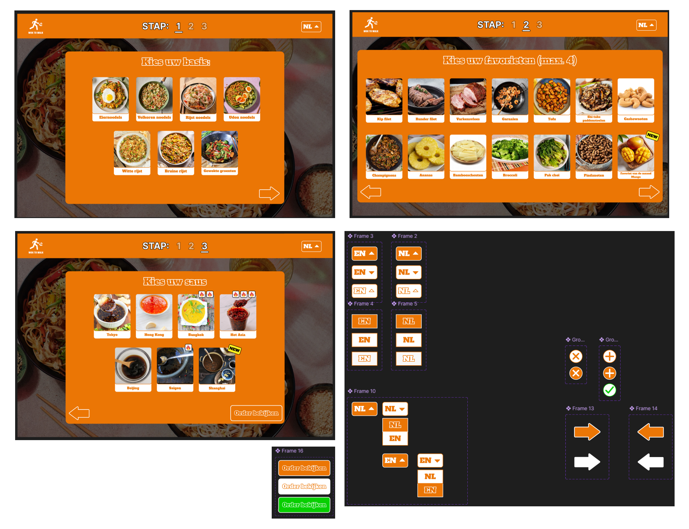

##### 2 sept - CSS: fonts met kleur en effecten 
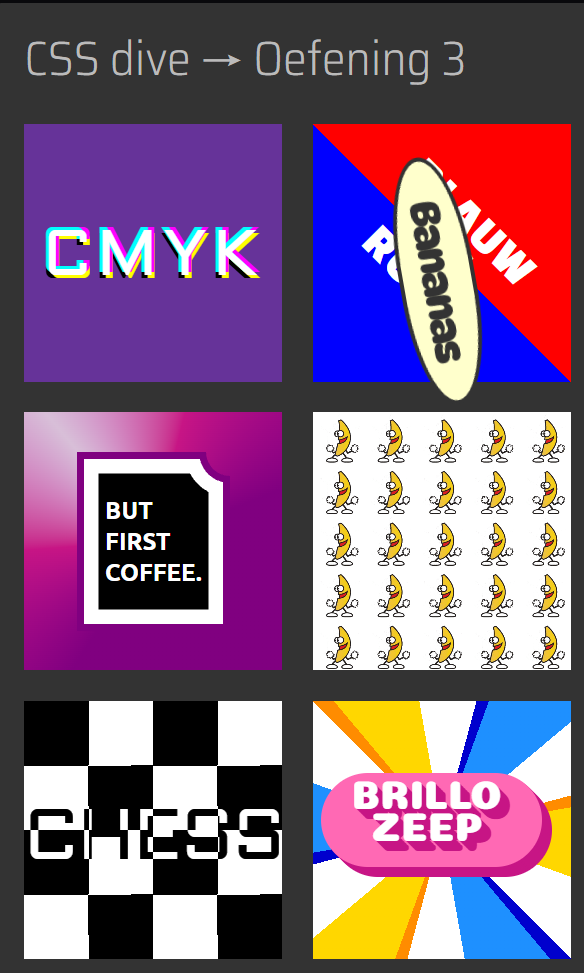

##### 4 sept - Praktische CSS
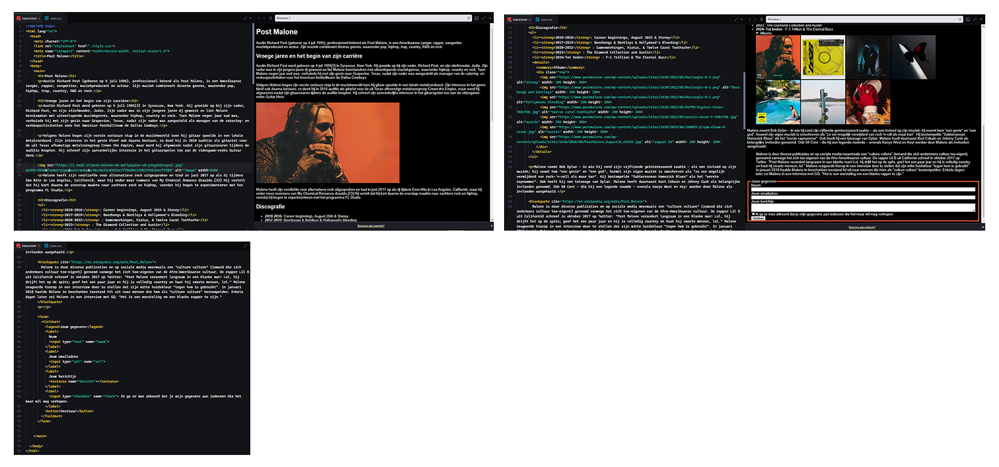

---

#### Week 2 — De eerste website en mijn onderwerpkeuze

Klik hier om Week 2 te bekijken

##### De saloon en homepage bouwen
Deze week heb ik het begin van mijn website gemaakt: de saloon als ingang en de homepage met mijn introductie over Country Music. De saloon had toen nog geen privacypopup en de homepage nog geen custom scrollbar. Die onderdelen horen bij latere versies van het ontwerp.

Ik heb ook een lichte modus gemaakt en de indeling aangepast voor kleine schermen. Daarbij was het belangrijk dat het ontwerp niet alleen op mijn eigen scherm paste, maar dat de inhoud en navigatie ook op een smaller scherm bruikbaar bleven.

| Eerste Iteratie Start| Eerste Iteratie Home | Tweede Iteratie Home |
| :---: | :---: | :---: |
| 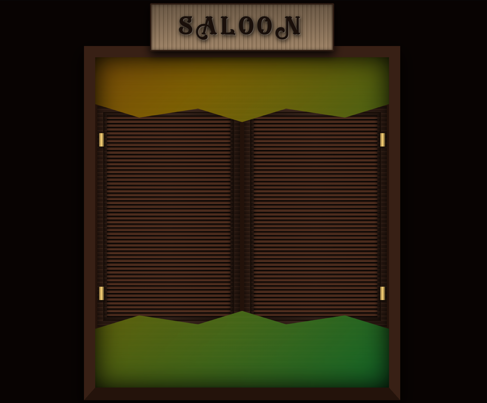 | 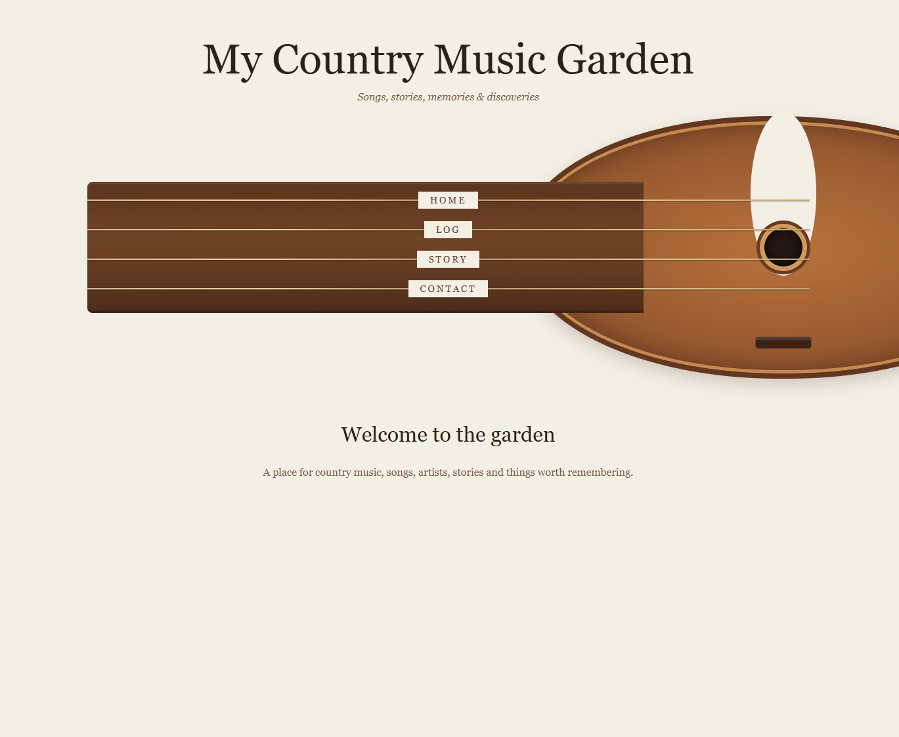 | 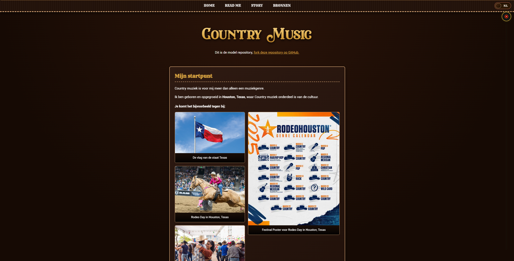 |

##### Mijn keuze voor Country Music uitleggen
Ik heb een presentatie gemaakt om aan een medestudent uit te leggen waarom ik Country Music als onderwerp voor mijn digital garden heb gekozen. Mijn persoonlijke startpunt is Houston, Texas, waar ik ben geboren en opgegroeid. Country muziek hoort voor mij bij de cultuur en biedt verschillende richtingen om verder te ontdekken: artiesten, muziekstijlen, rodeo, geschiedenis en invloeden uit andere genres.

De presentatie was bedoeld om duidelijk te maken hoe die onderwerpen met elkaar verbonden kunnen worden. Vanuit één artiest of nummer kan ik steeds een nieuw onderwerp onderzoeken. Dat sluit aan bij een digital garden die niet meteen af hoeft te zijn.

---

#### Week 3 — Taalkeuze, bronnen, scrollbar en HTML-validatie

Klik hier om Week 3 te bekijken

##### Nederlands en Engels
Deze week heb ik een vertaalfunctie toegevoegd, zodat bezoekers tussen Nederlands en Engels kunnen wisselen. De teksten staan samen in `translations.json` onder `NL` en `ENG`. In de HTML verwijzen de `data-i18n`-attributen naar de juiste teksten. De taalkeuze wordt bewaard in `localStorage`.

De taalwisselaar moest ook passen bij het mobiele menu. Op kleine schermen zat de knop het banjo-icoon in de weg. Daarom moest de taalkeuze daar in het uitklapmenu komen. Dit liet zien dat een nieuw onderdeel invloed heeft op de bestaande navigatie, ook wanneer het op een groot scherm wel goed past.

| Engels Vertaling | Nederlandse Vertaling |
| :---: | :---: |
| 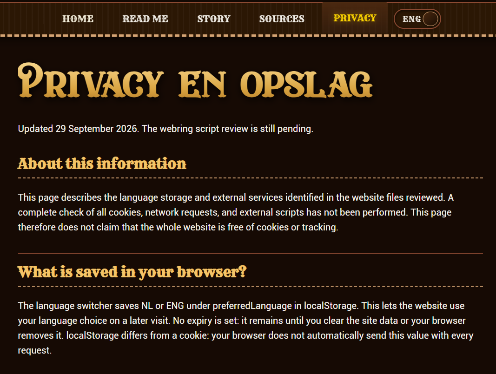 | 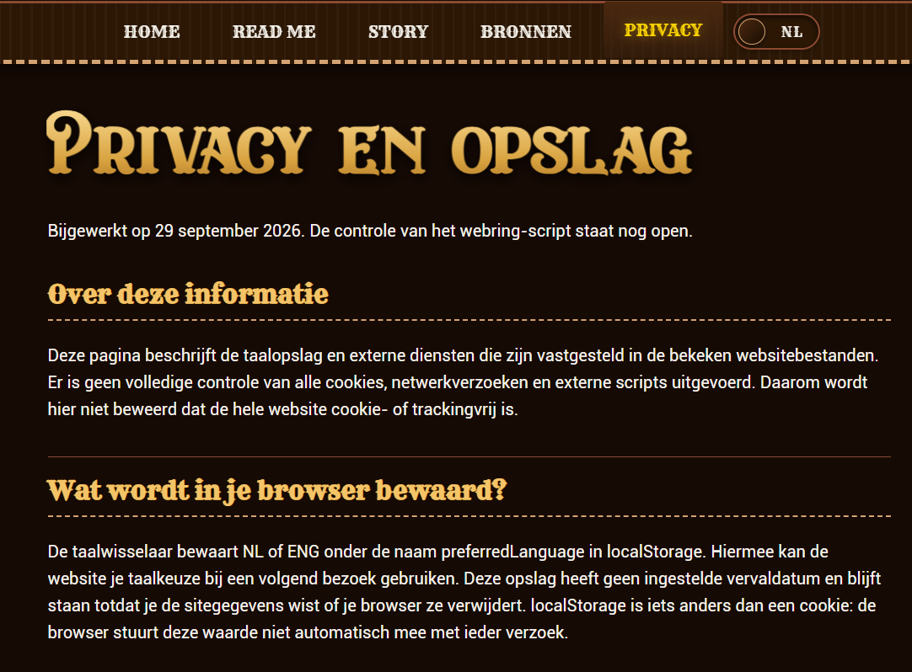 |

##### Een aparte bronnenpagina
Ik heb een bronnenpagina toegevoegd om de gebruikte afbeeldingen en onderzoeksbronnen bij elkaar te zetten. Bij de afbeeldingen staan onder andere de bestandsnaam, bron of uitgever en eventuele credits. De pagina heeft een zoekveld en categorieknoppen om afbeeldingen terug te vinden, en een apart overzicht voor onderzoek en literatuur.

Bij het vertalen moeten niet alleen koppen en alinea's worden meegenomen, maar ook knoppen, zoekteksten en de inhoud die JavaScript opbouwt. De categoriewaarden waarmee het filter werkt, kunnen hetzelfde blijven terwijl de zichtbare labels veranderen.

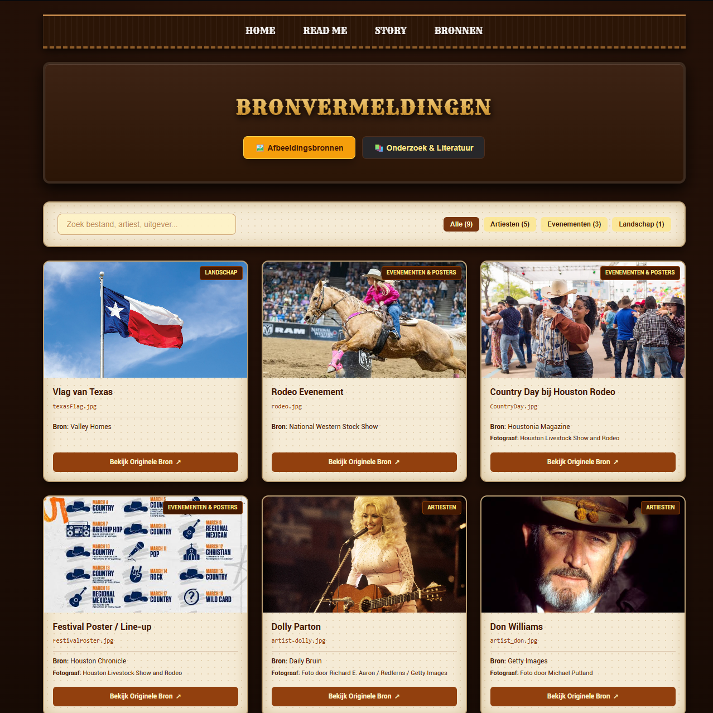

##### Custom scrollbar als vinylplaat
Deze week heb ik ook de custom scrollbar gemaakt. In plaats van de standaard scrollbar gebruikt mijn website een vinylplaat die bij het muziekthema past. Een gouden lijn laat zien hoe ver de bezoeker op de pagina is. Tijdens het scrollen verschijnen er muzieknoten rondom de plaat.

De vormgeving staat in `custom-scrollbar.css` en de interactie in `custom-scrollbar.js`. Zo kan ik de uitstraling aanpassen zonder de werking en styling door elkaar te zetten. Het ontwerp staat verderop in de README bij de componenten en micro-interacties. 

| | |
| :---: | :---: |
| De vormgeving staat in `custom-scrollbar.css` en de interactie in `custom-scrollbar.js`.   Zo kan ik de uitstraling aanpassen zonder de werking en styling door elkaar te zetten.   Het ontwerp staat verderop in de README bij de componenten en micro-interacties. | 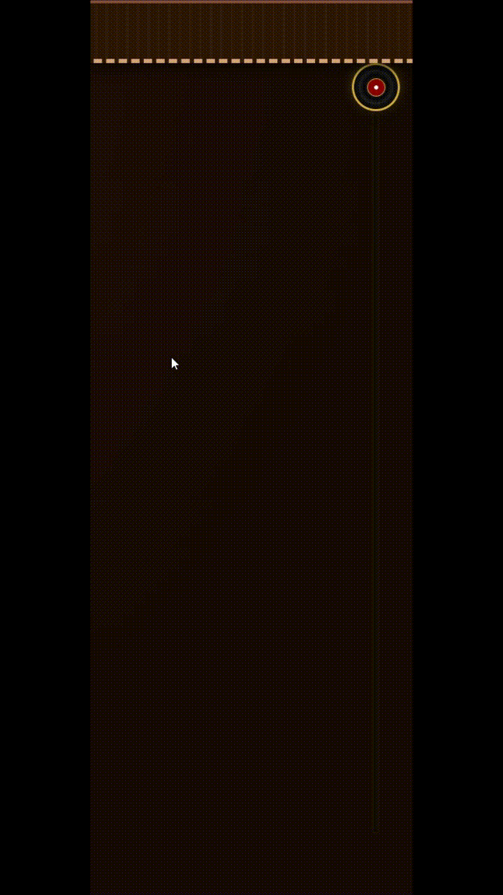 |
| | |

##### HTML-validatie
De validator gaf meldingen over een ontbrekende `src` bij de modalafbeelding, een dubbel gebruikt `modalImg`-ID en een `section` zonder kop. Deze meldingen maakten duidelijk dat een alt-tekst geen afbeeldingsbron vervangt en dat een ID maar één keer op een pagina mag voorkomen. Een inhoudelijke sectie heeft een passende kop nodig.

IDs zijn wel nuttig voor gerichte verwijzingen: bijvoorbeeld een skip link naar de hoofdinhoud, een label dat naar een invoerveld verwijst of `aria-labelledby` dat een dialoog met zijn titel verbindt. De laatste versies moeten opnieuw door de validator; hier staat nog geen bevestiging dat alle meldingen zijn opgelost.

| Eerste Error | Tweede Error |
| :---: | :---: |
| 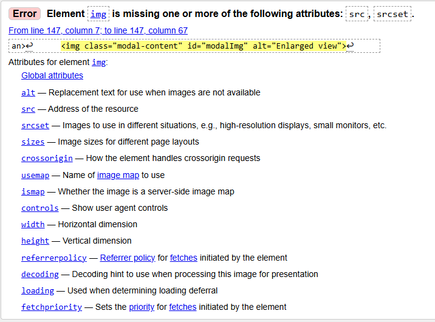 | 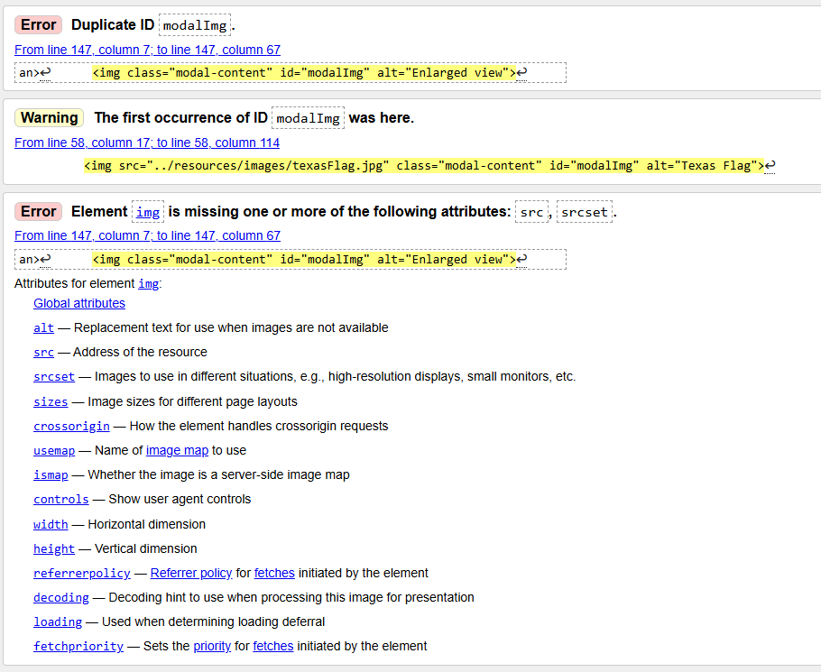 |

---

#### Week 4 — Thema's, toegankelijkheid en het begin van mijn garden

Klik hier om Week 4 te bekijken

##### Lichte en donkere modus uitbreiden
Deze week heb ik lichte en donkere modus ook aan mijn andere pagina's toegevoegd. In die iteratie volgden de pagina's de systeemvoorkeur via `prefers-color-scheme`. Later is dit verder uitgewerkt naar een expliciete zon-/maanknop, opgeslagen voorkeur en een gedeeld `data-theme`. Daarbij moeten tekst, achtergronden, knoppen en focusranden bij elkaar passen. Alleen de achtergrond lichter maken is niet genoeg als de tekst ook licht blijft.

##### Werken aan toegankelijkheid
Ik heb gewerkt aan de bruikbaarheid met een screenreader en aan andere toegankelijkheidsaspecten, zoals bediening met het toetsenbord, duidelijke labels en zichtbare focus.

Voor het testen is Edge gekozen. Bij het doorlopen van de bronnenpagina werd gemeld dat het zoekveld en de filters te weinig uitleg gaven. Een bronlink las alleen ‘Bekijk Originele Bron’ voor, zonder duidelijk te maken bij welke afbeelding die hoorde.

Daarvoor zijn de volgende aanpassingen uitgewerkt:

- Het zoeklabel koppelen aan het juiste input-ID en de werking uitleggen via `aria-describedby`.
- Filterknoppen een beschrijving geven en de geselecteerde staat communiceren met `aria-pressed`.
- Bronlinks een naam geven zoals ‘Bekijk Originele Bron — Vlag van Texas — Bron: Valley Homes’, met aanvullende informatie over bestand en credits.
- Het aantal zoekresultaten laten melden zonder bij elke toetsaanslag direct een nieuwe melding te geven.
- Skip links toevoegen zodat de navigatie kan worden overgeslagen.
- Extra linkcontext visueel verbergen, terwijl deze voor screenreaders beschikbaar blijft.

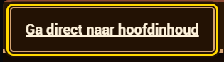
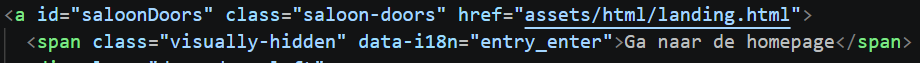

Tab doorloopt de interactieve elementen. De gewone tekst van een bronkaart hoeft daarom geen aparte Tab-stop te worden. Die tekst blijft via de leescommando's van de screenreader beschikbaar. De precieze uitspraak moet nog met de gebruikte screenreader worden vastgelegd.

Bij de saloondeuren is daarnaast gewerkt aan een echte link, een verborgen toegankelijke naam en het behouden van de zichtbare ‘Come In!’-tooltip. In een aangeleverde scriptversie kwamen een niet-overeenkomende selector en verschillende schrijfwijzen van variabelen voor. Dit liet zien hoe belangrijk het is dat HTML, CSS en JavaScript dezelfde namen gebruiken.

Dit beschrijft de werkzaamheden en gevonden problemen. De gebruikte screenreader, versie en concrete uitkomsten van de controles moet ik nog toevoegen; daarmee kan ik laten zien wat daadwerkelijk is gecontroleerd.

##### Een start maken met de story-pagina
Ik heb een story-pagina toegevoegd als begin van mijn digital garden. Daarmee kreeg de website naast de introductie en bronnen ook een plek voor onderwerpen en notities die ik verder kan uitwerken. De verdere uitwerking van deze pagina staat bij de latere verfijningen hieronder.

#### Week 5 — Destijdse tussenstand: opruimen en verder verfijnen

Klik hier om Week 5 te bekijken

##### CSS overzichtelijker maken
De stylesheets zijn apart doorgenomen: `bronnen.css`, `custom-scrollbar.css`, `landing.css`, `language-changer.css`, `navbar.css`, `privacy.css`, `story.css` en `style.css`. De afgesproken volgorde is `:root`, eventuele `@font-face`-regels, de overige styling en onderaan de media queries. De hoofdonderdelen krijgen herkenbare `MARK:`-commentaren. Waar nog Flexbox stond, is een Grid-uitwerking gemaakt, omdat Grid een eis is voor mijn project.

| @font-face | :root |
| :---: | :---: |
| 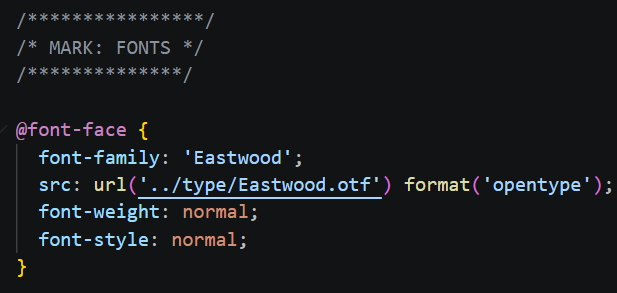 | 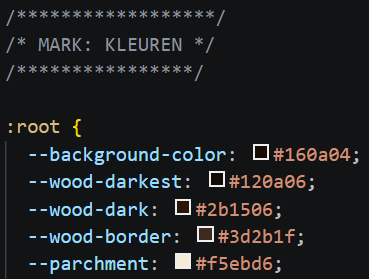 |

##### Een kleurconflict in lichte modus oplossen
Op de homepage was tekst in lichte modus bijna niet leesbaar. De achtergrond was licht, maar de tekst bleef ook licht. In de stylesheets werd `--main-font-color` op meerdere plekken in `:root` ingesteld. Een later geladen stylesheet kon daardoor de kleur overschrijven. De oplossing is om de inhoud eigen kleurvariabelen te geven, zodat de navigatie de tekstkleur van de pagina niet bepaalt.

Dit was een verdere verbetering van de thema's uit de eerdere weken. De kleuruitwerking is ook bij de bronnenpagina, privacypagina en privacymelding nagelopen. De laatste versies moeten nog in beide modi worden gecontroleerd, inclusief hover, toetsenbordfocus en open popups.

| Eerste Iteratie | Finale Versie |
| :---: | :---: |
| 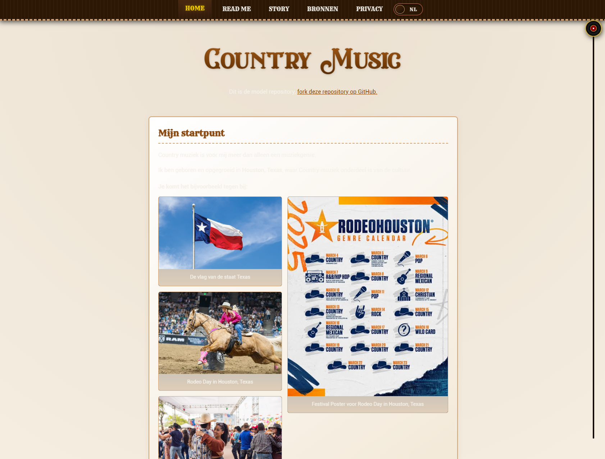 | 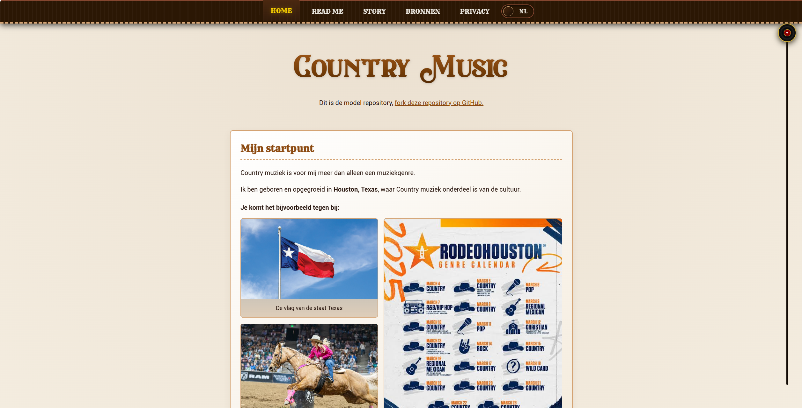 |
| *Procesfase home pagina* | *Uiteindelijke versie* |

##### Afbeeldingen vergroten zonder de indeling kwijt te raken
Bij de afbeeldingspopup zag ik een groot bruin vlak, scrollruimte en later veel ruimte tussen de foto en het bijschrift. De popup-CSS is daarop aangepast. Het doel is nu een foto met een passende maximale grootte, een rand en een aansluitend bijschrift met dezelfde breedte. De sluitknop staat rechts naast de afbeelding en toont een X. De knop kan voor een screenreader nog steeds de naam ‘Sluiten’ hebben.

De extra ruimte kwam in de gebruikte uitwerking door een dialoog die verticaal kon uitrekken en Grid-rijen die de overgebleven hoogte verdeelden. Hiervoor is een inhoudsafhankelijke hoogte uitgewerkt. Een volgende controle is om zowel staande als liggende foto's op een klein scherm te openen en te kijken of de sluitknop en het volledige bijschrift bereikbaar blijven.

##### De story-pagina verder uitwerken tot Country Roots
De in week 4 begonnen story-pagina is verder uitgewerkt als one-pager met de titel **Country Roots — Mijn muzikale tuin**. De inhoud gebruikt mijn bestaande startpunt in Houston, Texas en de vijf artiesten van de homepage: Dolly Parton, Don Williams, Ella Langley, Kameron Marlowe en Warren Zeiders.

De opzet bestaat uit mijn wortels, een doorzoekbare artiestenverzameling en eerste notities over muziekstijlen, cultuur en invloeden. De notities linken naar verwante onderwerpen en de bronnenpagina. Onderzoeksvragen zijn als vragen geformuleerd; ze zijn nog geen uitgewerkte onderzoeksresultaten. HTML, CSS en JavaScript staan in aparte bestanden. Nieuwe vertaalteksten zijn als aanvulling op het bestaande JSON-bestand aangeleverd.

De inhoudslinks hebben een CSS-uitwerking voor soepel scrollen. Bij `prefers-reduced-motion` blijft de sprong direct. Zo kan een kleine interactie aansluiten op de voorkeur van de bezoeker.

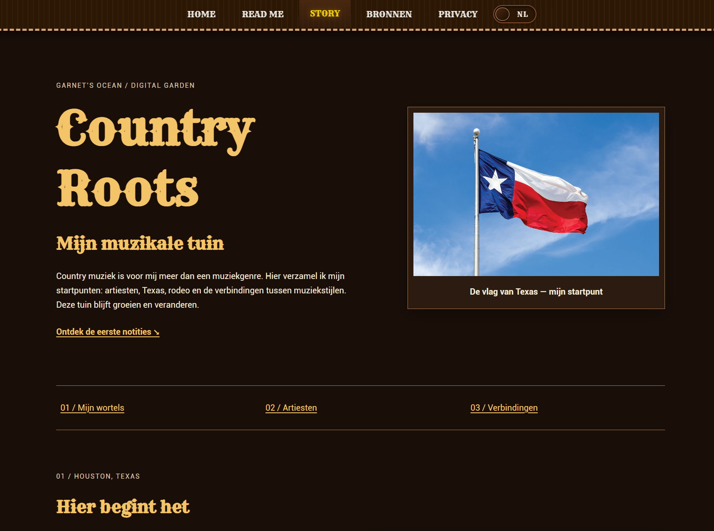

##### Nog zelf aanvullen voor deze week
- Welke van deze bestanden heb ik overgenomen en gepubliceerd? Voeg de commit of datum toe.
- Wat kan ik inmiddels zelf uitleggen of aanpassen zonder het voorbeeld erbij?
- Welke feedback heb ik van een docent of medestudent gekregen?
- Welke controles heb ik uitgevoerd en wat waren de resultaten?

##### Navigatie en taalwisselaar

De actieve paginalink moet overeenkomen met de huidige pagina; op een eerder screenshot werd ‘Bronnen’ gemarkeerd terwijl de homepage openstond.

Bij het hergebruiken van de taalwisselaar bleek dat `nav #langToggleBtn` alleen een knop binnen de navigatie selecteert. Voor dezelfde knop in de privacypopup moest de selector ook buiten `nav` werken. Tegelijk mogen de algemene popupknoppen de styling van de taalwisselaar niet overschrijven.

##### Privacy en opslag

Er is een informatieve melding voor `index.html` uitgewerkt, met een uitgebreidere privacypagina in de navigatie. De melding gaat onder andere over de opgeslagen taalkeuze en externe diensten. Het sluiten van de melding is niet bedoeld als toestemming voor tracking.

Ik wil hier onderscheid maken tussen cookies, `localStorage` en verzoeken naar andere diensten. Alleen geen cookies zien is onvoldoende om te concluderen dat er nergens gegevens worden verwerkt. De volledige controle van het externe webring-script en het netwerkverkeer staat nog open. De uiteindelijke privacytekst moet overeenkomen met wat de website daadwerkelijk doet.

| Pop-up Oud | Pop-up Nieuw |
| :---: | :---: |
| 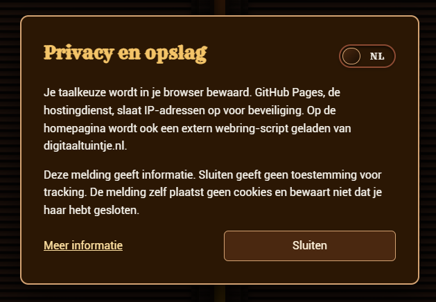 | 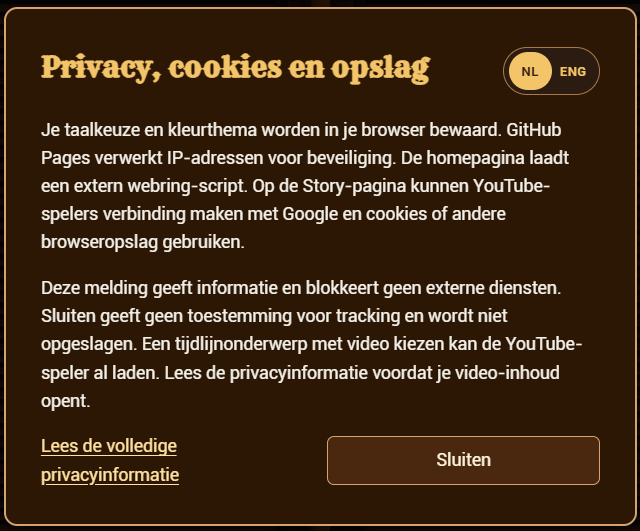 |

---

#### Week 6 — Play the Rules

Klik hier om week 6 te lezen

##### Typografieopdracht: Play the Rules — eerste iteratie
De schetsen, screenshots en ontwerpkeuzes in dit onderdeel beschrijven de oorspronkelijke zwart-witte versie met losse composities. De latere doorlopende pagina met één terugkerend thema staat bij de aanvulling van 22 oktober.

| | Schetsen | |
| :---: | :---: | :---: |
| 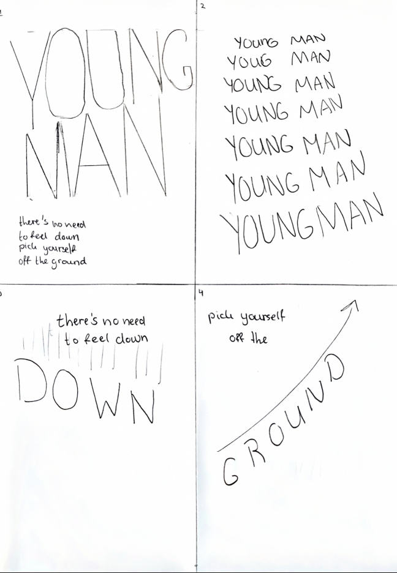 | 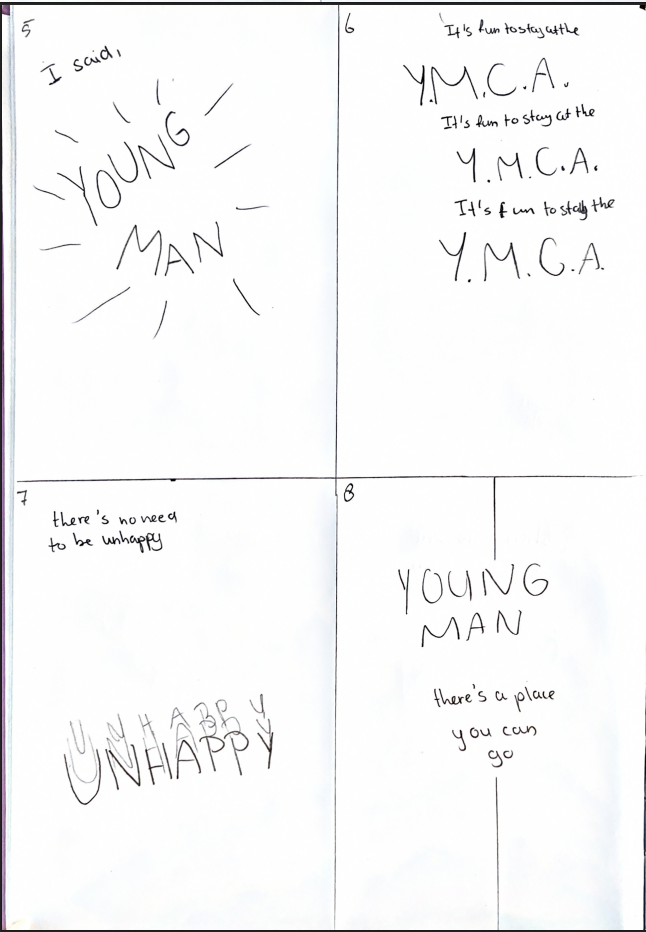 | 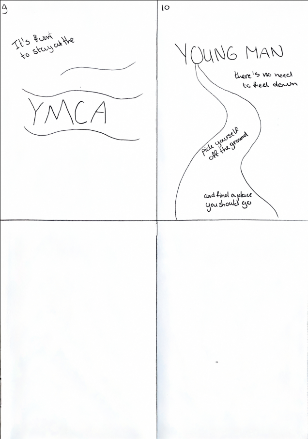 |

| Digitale uitwerking |
| :---: |
| 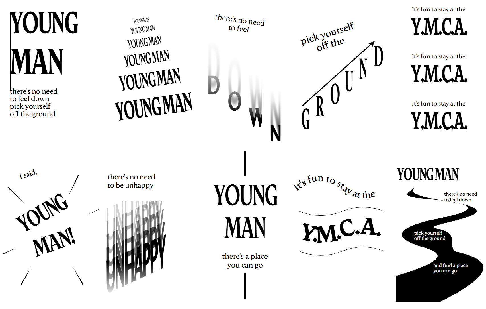 |

---
##### Ontwerpkeuzes
Voor dit ontwerp heb ik de songtekst van *Y.M.C.A.* gebruikt als uitgangspunt. Ik wilde de energie en betekenis van de tekst zichtbaar maken met typografie. Daarom heb ik gespeeld met lettergrootte, gewicht, herhaling, richting en witruimte.

Ik heb gekozen voor zwarte tekst op een witte achtergrond. Zo ligt de aandacht op de letters en hun compositie. De onderdelen hebben geen kaders of nummers, waardoor de pagina meer als één geheel leest. De witruimte zorgt ervoor dat de verschillende effecten elkaar niet verdringen.

*Typografie en compositie*

| Omschrijving | Uitwerking |
| :---: | :---: |
| **YOUNG MAN** staat aan het begin groot en zwaar om meteen de aandacht te trekken. De verticale lijn links verbindt de woorden met de kleinere songtekst eronder. | 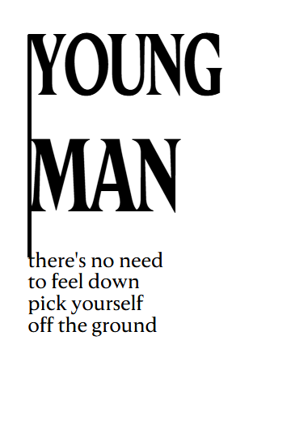 |
| Bij de herhaalde **YOUNG MAN** worden de woorden steeds groter en zwaarder. Dit geeft een visuele opbouw, vergelijkbaar met een stem die steeds krachtiger klinkt. De lichte draaiing geeft de compositie extra beweging. | 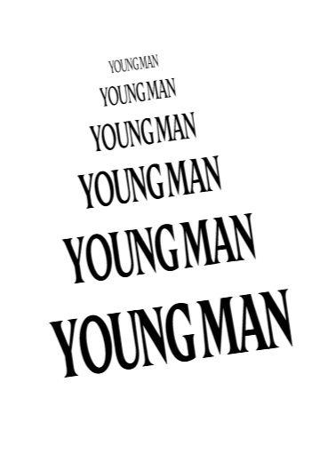 |
| Bij **DOWN** loopt de tekst van vaag naar duidelijk zichtbaar. De letters staan steeds lager, zodat hun positie de betekenis van het woord ondersteunt.  | 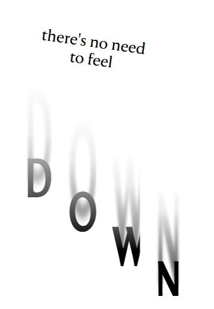 |
| **GROUND** loopt juist omhoog. De pijl volgt dezelfde richting en sluit aan bij de aanmoediging om jezelf weer op te pakken. | 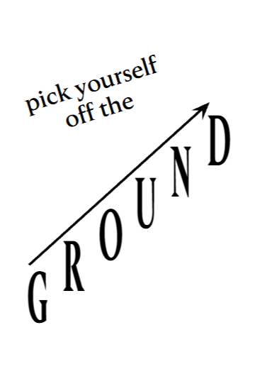 |
| Het refrein **Y.M.C.A.** wordt drie keer herhaald. Deze herhaling maakt het ritme van het nummer zichtbaar.  | 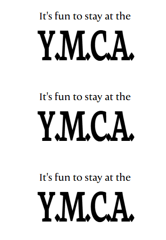 |
| Bij **I said, YOUNG MAN!** zorgen de schuine woorden en de strepen eromheen voor nadruk, alsof de tekst wordt geroepen. | 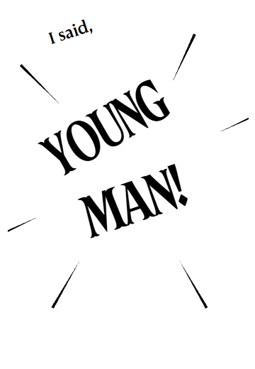 |
| **UNHAPPY** bestaat uit overlappende lagen die steeds donkerder en zwaarder worden. Dit geeft het woord meer visueel gewicht. Daarna volgt een rustigere compositie: gecentreerde tekst met twee verticale lijnen. Dat zorgt voor afwisseling tussen drukke en rustige delen. | 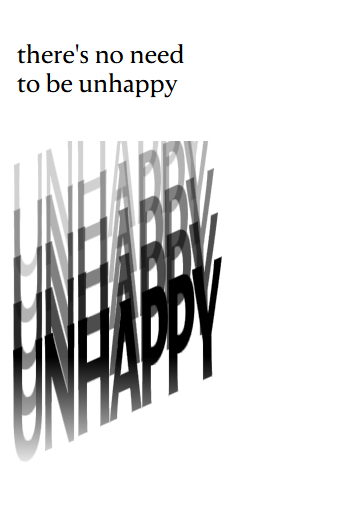 |
| Een minimalistiche design zodat het de nadruk legt op **YOUNG MAN** | 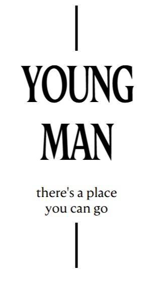 |
| De golvende versie van **Y.M.C.A.** sluit aan bij het dansbare karakter van het nummer. | 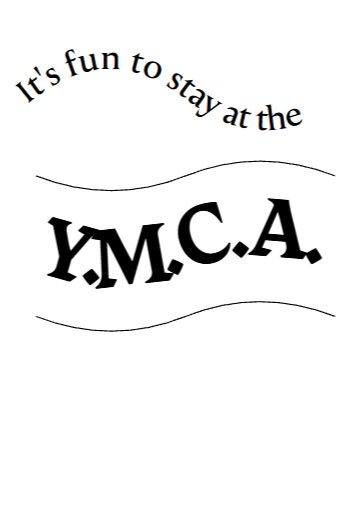 |
| De slingerende weg aan het einde verbeeldt het zoeken naar een plek waar je naartoe kunt gaan. De tekst staat deels op de weg, zodat vorm en inhoud samenkomen. | 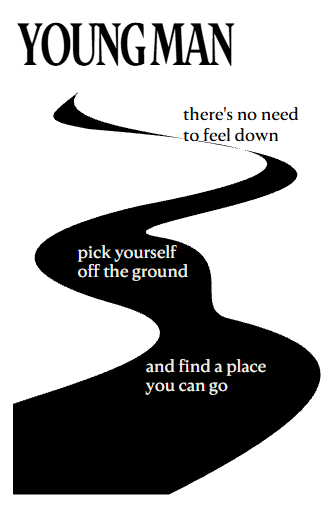 |

*Het variabele lettertype*

Ik heb **Seraphs** gekozen omdat dit variabele lettertype verschillende gewichten en schreefvormen bevat. Met `font-weight` verander ik hoe licht of zwaar de letters zijn. Met de `SRFS`-as wissel ik tussen onder andere schreefloze, serif-, slab-, wedge- en kalligrafische vormen.

Hierdoor krijgen de onderdelen een eigen uitstraling, terwijl ze toch hetzelfde lettertype gebruiken. De zwaardere varianten geven nadruk; de lichtere varianten houden de kleinere songtekst leesbaar.

*Technische keuzes*

De HTML bevat de tekst en de structuur. De vormgeving staat in een apart CSS-bestand, zodat beide overzichtelijk blijven. Elk onderdeel heeft één herkenbare class; de elementen daarbinnen worden zoveel mogelijk met eenvoudige selectors gestyled.

Voor de afmetingen gebruik ik vooral relatieve eenheden zoals `em`, `%` en `vw`. Hierdoor kunnen tekst en composities meeschalen met het scherm. Met `line-height` regel ik de afstand tussen tekstregels. CSS Grid verdeelt de onderdelen over de pagina, terwijl media queries het aantal kolommen aanpassen op kleinere schermen.

Voor de golvende tekst en de weg gebruik ik SVG. Daarmee kan tekst een gebogen pad volgen en blijven de vormen scherp wanneer ze groter of kleiner worden weergegeven.

---

#### Week 8 — Stand op 22 oktober: samenhang en verdere uitwerking

Klik hier om de recente uitwerkingen te lezen

##### Country Roots als doorlopende Story-pagina
De eerste paginaopzet is uitgegroeid tot een verhaal met verschillende ingangen. De bestemmingskaarten linken naar introductie, geschiedenis, muzikale wortels, muziekstijlen, artiesten en bronnen. Op grotere schermen helpt een uitschuifbaar concertticket bij het navigeren. De actieve sectie wordt gemarkeerd. Op kleine schermen is een terug-naar-bovenlink uitgewerkt.

De gitaartijdlijn bevat zes perioden en achttien gebeurtenissen. De stemknoppen kiezen een periode; de gebeurtenissen op de hals en in de bijbehorende lijst kiezen het verhaal. De kaart toont tekst, een afbeelding of video en een passende bronlink. Van de achttien gebeurtenissen gebruiken er elf een afbeelding en zeven een YouTube-video.

Bij de muzikale wortels is een interactieve viool uitgewerkt. Het uit elkaar halen van de onderdelen gebeurt met een checkbox en CSS; de selectie van een onderwerp gebruikt JavaScript. De onderdelen verbinden ballades en folk, banjo en fiddle, blues, gospel en grensgebieden met het ontstaan van country. De artiestenverzameling blijft doorzoekbaar en sorteerbaar; de dialoog toont een korte beschrijving en muziekstijlen.

| Intro | Geschiedenis | Muzikale wortels |
| :---: | :---: | :---: |
| 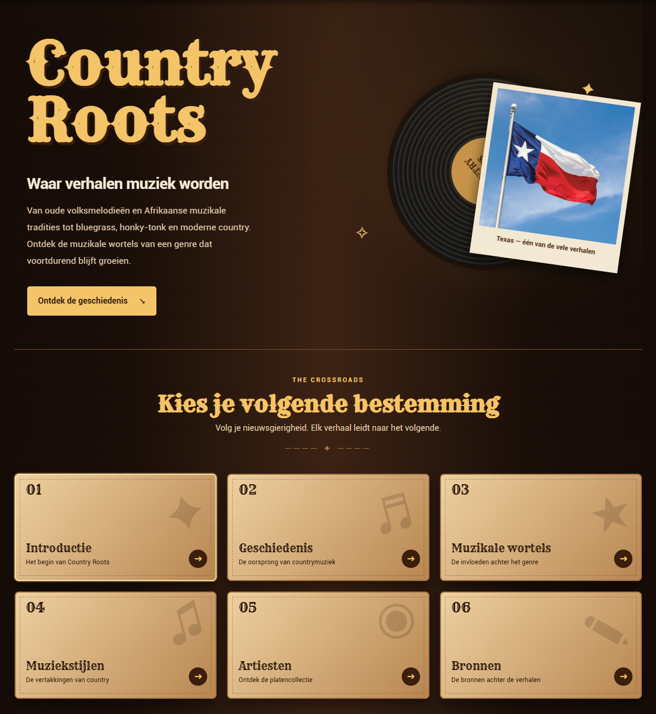 | 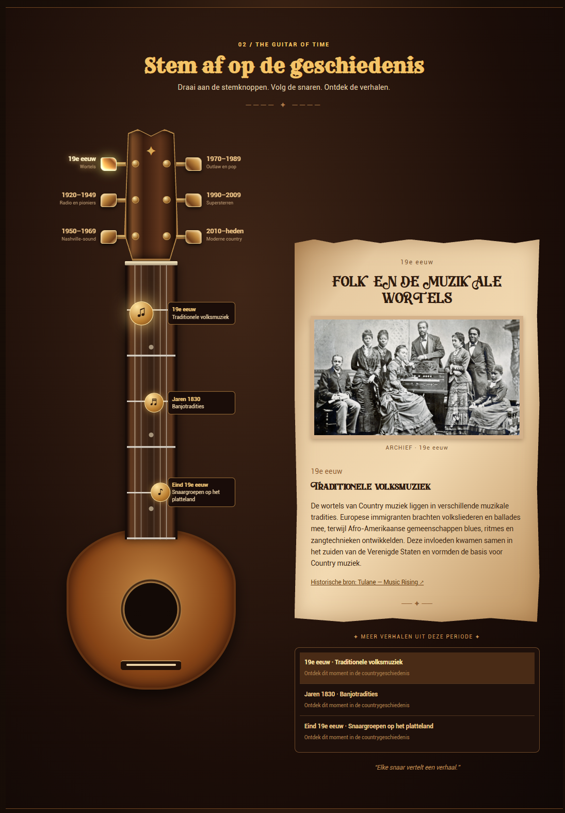 | 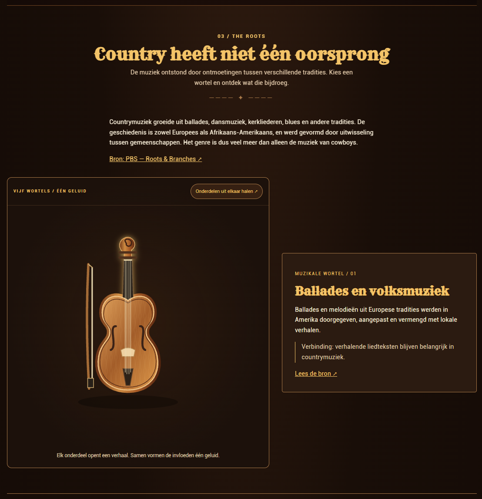 |

| Muziekstijlen | Artiesten |
| :---: | :---: |
| 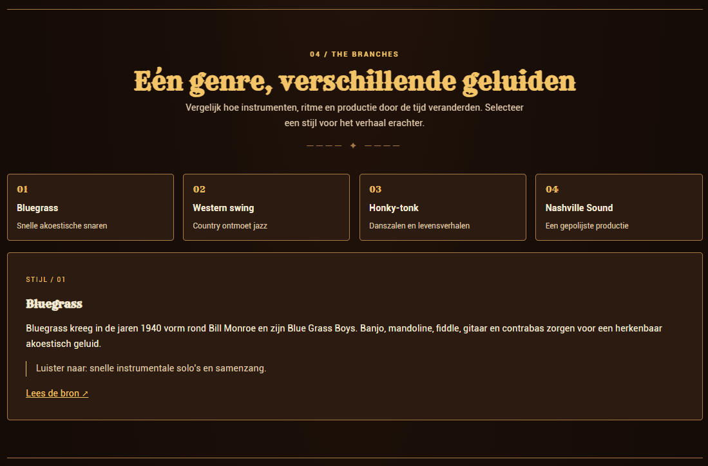 | 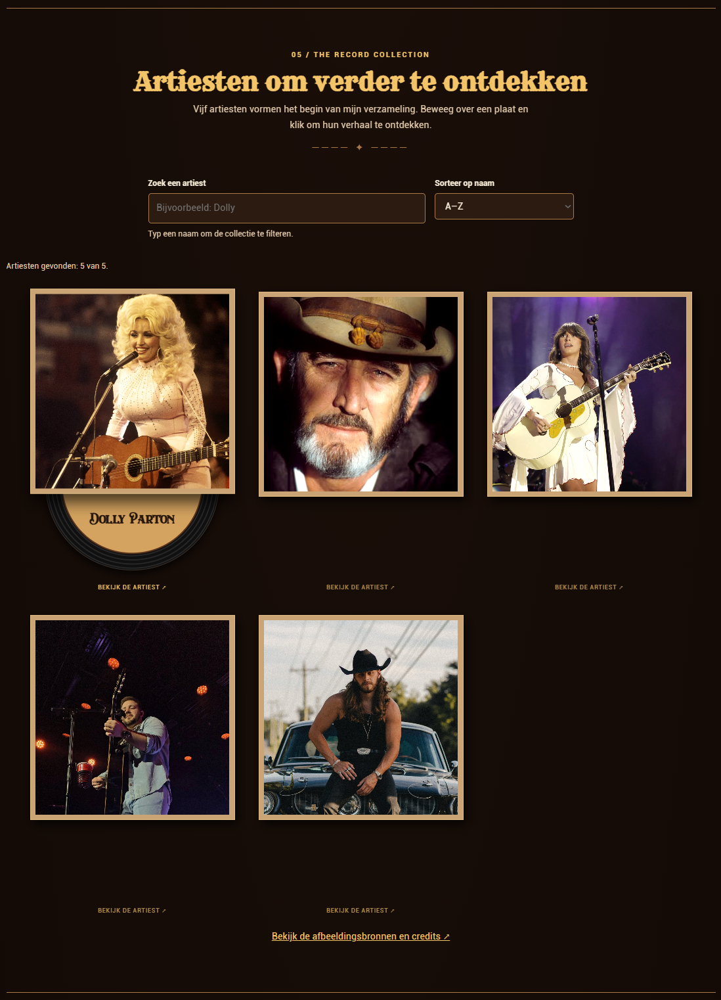 | 

##### Ook dynamische inhoud vertalen
Alleen sleutels toevoegen aan JSON bleek niet voldoende: de HTML moet die sleutels gebruiken en JavaScript mag de vertaalde inhoud niet opnieuw met vaste Nederlandse tekst overschrijven. Daarom zijn `data-i18n`-verwijzingen toegevoegd en gebruiken de tijdlijn en artiestendialoog de vertaalfunctie. Het event `languagechange` werkt de dynamische onderdelen bij.

Bij het wisselen van taal moeten de gekozen periode, gebeurtenis, zoekterm en open dialoog behouden blijven. Een spelende video wordt daarom niet opnieuw aangemaakt als alleen de teksttaal verandert. Ook labels, afbeeldingsbeschrijvingen en knopcontext horen bij deze vertaaluitwerking.

| Oude toggle button | Nieuwe toggle button |
| :---: | :---: |
| 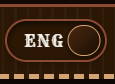 | 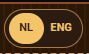 |

##### Een gedeeld thema en herkenbare bediening
De oorspronkelijke donkere kleuren zijn behouden als donkere modus. Voor lichte modus is een warme, lichtere variant uitgewerkt. De navigatie behoudt in beide modi haar houtstructuur en stikselaccenten. De zon-/maanknop en de NL/ENG-knop hebben een verwante vorm, zodat ze als bedieningsknoppen bij elkaar horen.

De themakleuren staan in `lightDark.css`; de opslag en bediening in `lightDark.js`. Kleuren die in losse paginastylesheets bleven staan, konden de centrale themawaarden overschrijven. Daarom is de lichte uitwerking ook op de Story-, bronnen- en privacypagina nagelopen. Bij de bronnenkaarten zijn de witruimte, het contrast en de padding van onderzoeksitems verder uitgewerkt.

| | |
| :---: | :---: |
| 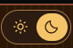 | 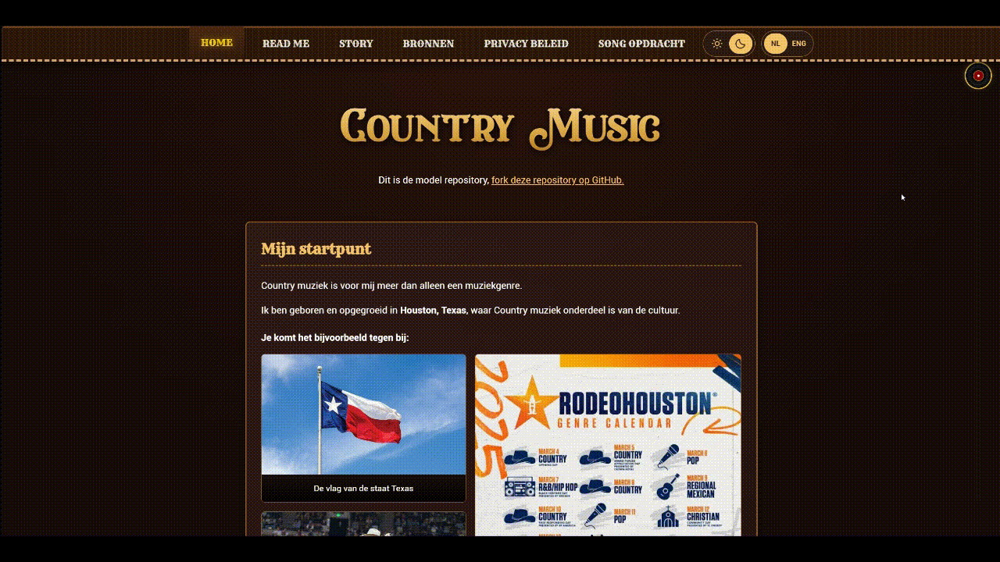 |

##### Privacy-informatie en een vintage ansichtkaart
De privacy-informatie is uitgebreid met de opgeslagen taal- en themakeuze en de ingesloten YouTube-spelers op `youtube-nocookie.com`. De melding op het startscherm is informatie; het sluiten ervan is geen toestemming voor tracking. De huidige uitwerking is geen toestemmingsmanager die externe spelers vooraf blokkeert.

Tijdens de verkenning werden na interactie Google-cookies zichtbaar en werden opslagitems van de speler aangetroffen. In enkele bekeken verzoeken ontbraken `Cookie`- en `Set-Cookie`-headers. Dit was onvoldoende om voor alle verzoeken vast te stellen wat werd geplaatst of gelezen. Die onzekerheid blijft ook in de documentatie benoemd.

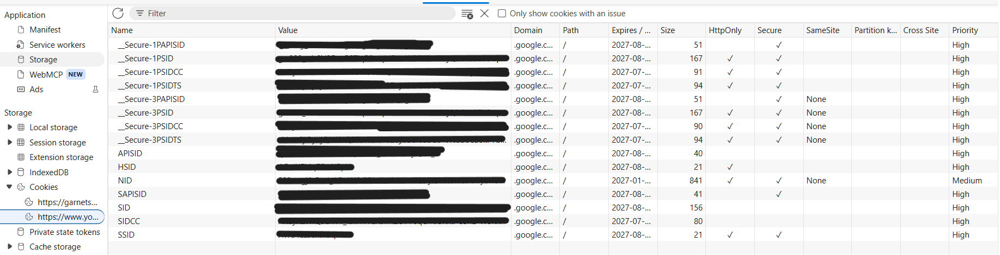
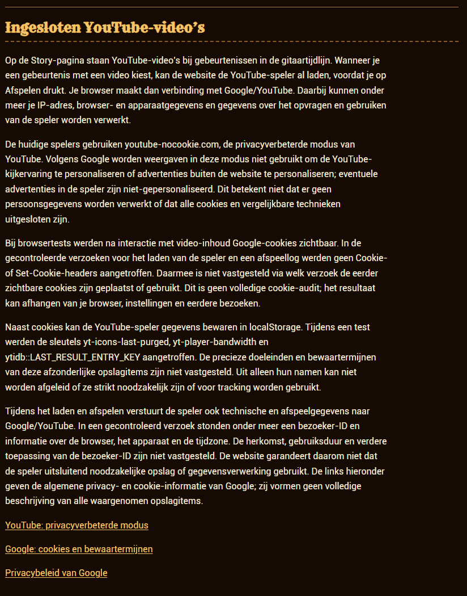

Op de privacypagina staat daarnaast een demoformulier als vintage ansichtkaart. Naam, e-mailadres en vraag zijn verplicht. Bij ongeldige invoer verschijnt een foutmelding, wordt het betreffende veld gemarkeerd en krijgt het eerste ongeldige veld focus. Na geldige invoer verschijnt een bevestigingsdialoog. De vraag wordt niet echt verstuurd of opgeslagen; het formulier is niet bedoeld voor echte privacyverzoeken.

| Privacy schetsen | 
| :---: |
| 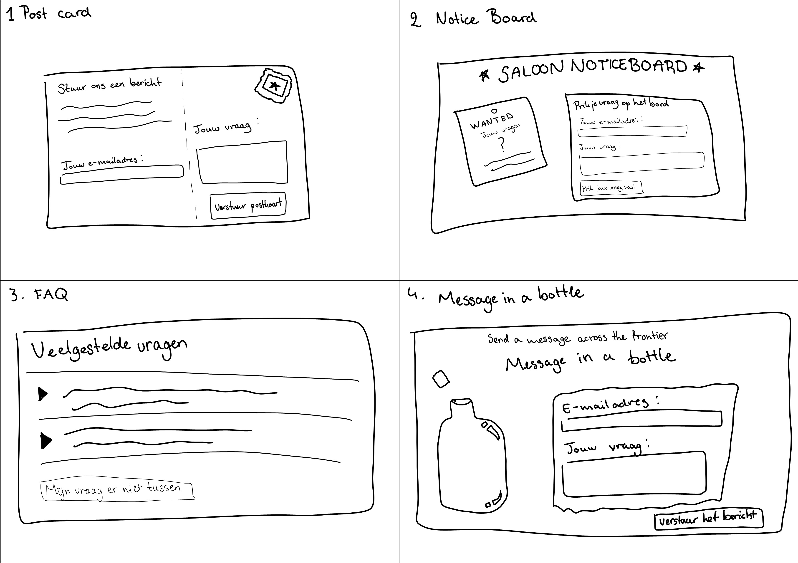 |

| Privacy Experiment 1 | Privacy Experiment 2 | Privacy Experiment 3 / Final |
| :---: | :---: | :---: |
| 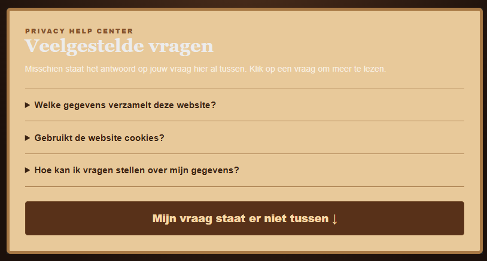 | 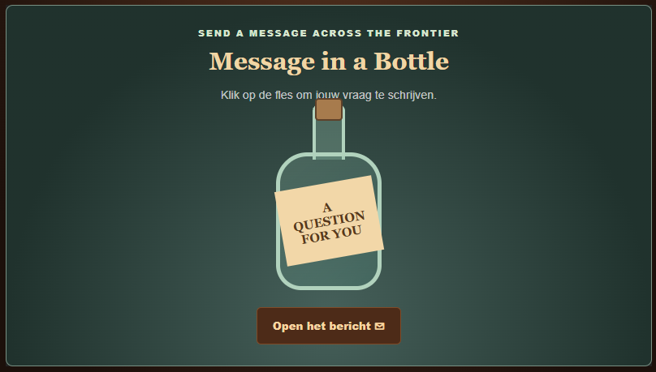 | 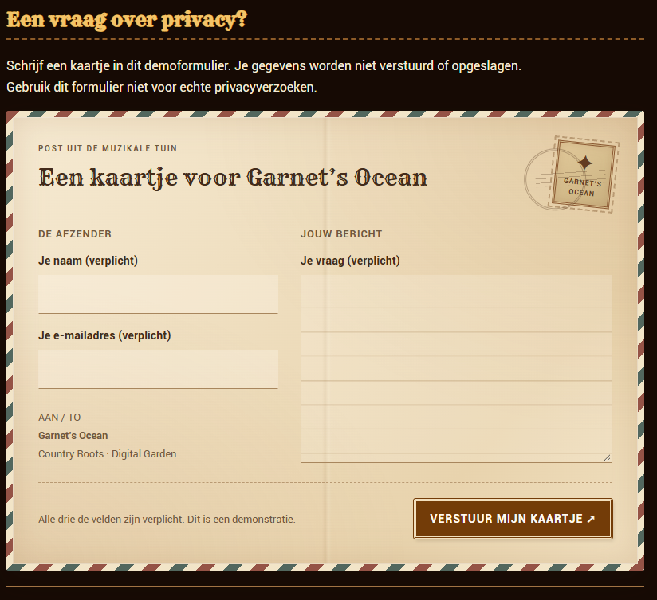 |

Voor het countrygedeelte gebruik ik de aangeleverde lettertypen Eastwood, Rye en Roboto. De gecontroleerde bestanden hiervan zijn statisch. Roboto Regular en Bold zijn afzonderlijke gewichten; ik behandel deze bestanden niet als een variabel font.

##### De bronnenpagina laten meegroeien met de inhoud
De laatste bronnenuitwerking bevat twintig afbeeldingen: negen bestaande credits en elf nieuwe tijdlijnbeelden. De nieuwe categorie **Tijdlijn** heeft elf items; de bestaande categorieën bevatten vijf artiesten, drie evenementen/posters en één landschap. De aantallen worden uit de gegevens berekend, zodat ze bij verdere toevoegingen niet handmatig in de knoppen hoeven te worden gewijzigd.

Een derde overzicht verzamelt zeven YouTube-links uit de Story-tijdlijn. Hier staan de titel, de bij de tijdlijn genoemde artiest en de periode. De bronpagina laadt hiervoor geen extra videospelers of externe thumbnails. De artiestnaam is geen veronderstelde uploader of kanaalnaam. De opgegeven herkomst van `outlaw_2.jpg` blijft **Oluwaseyi Davies**, als directe vermelding zonder verzonnen bronlink.

Zoeken, filteren en wisselen tussen de overzichten blijven werken bij Nederlands/Engels. De elf nieuwe afbeeldingscredits en zeven videolinks staan ook in de bronnentabellen onderaan deze README.

##### De viool als interactieve uitleg van de muzikale wortels
Voor dit onderdeel is een viool in SVG uitgewerkt. In de samengevoegde toestand vormt die één instrument. Wanneer de bezoeker de onderdelen uit elkaar haalt, worden vijf ingangen naar de achterliggende verhalen zichtbaar. Het instrument verbindt de losse onderwerpen visueel: verschillende invloeden vormen samen één geluid.

De koppelingen zijn een visuele manier om door het onderzoek te navigeren; ze betekenen niet dat een specifiek vioolonderdeel historisch één muziektraditie vertegenwoordigt. Bij ieder onderwerp staat uitleg, een verbinding met country en een bronlink om verder te lezen.

Het uit elkaar halen en samenvoegen gebruikt een gelabelde checkbox en CSS met `:has(:checked)`. JavaScript verwerkt de keuze van een onderwerp, markeert het bijbehorende onderdeel en toont het passende verhaal. De onderwerpknoppen communiceren hun selectie via `aria-pressed`; de focus blijft op de gekozen knop. De teksten en labels zijn ook aangesloten op de Nederlandse en Engelse vertalingen.

Hierdoor is Roots veranderd van een korte persoonlijke introductie naar een inhoudelijk onderzoeksdeel dat de bezoeker zelf kan verkennen. De terugkerende viool, warme kleuren en materiaaluitstraling houden het onderdeel verbonden met de rest van Country Roots.

| Oude Versie |
| :---: |
|  |

| Schetsen voor vernieuwing |
| :---: |
|  |

| Roots Experiment 1 | Roots Experiment 2 | Roots Experiment 3/final | 
| :---: | :---: | :---: |
|  |  |  |

##### Y.M.C.A.: van losse composities naar één geheel
De eerste versie bestond uit verschillende typografische experimenten. De feedback was om één terugkerend thema te maken en de mogelijkheden van SeraphsVF bewuster te gebruiken. De nieuwe uitwerking volgt daarom één doorlopende leesrichting, met een warme papierkleur, violette letters, limekleurige accenten, terugkerende sterren en een vloeiende lijn langs de tekst. Deze opdracht staat los van de countryvormgeving.

Ik gebruik alleen de zestien aangeleverde tekstregels, in dezelfde volgorde. Er zijn geen extra songteksten of dubbele decoratieve tekstlagen toegevoegd. Kop en artiest vermelden Y.M.C.A. en Village People.

Het aangeleverde `SeraphsVF.woff2` heeft twee gecontroleerde variabele assen: `wght` van **100 tot 200** en `SRFS` van **0 tot 60**. De fontdeclaratie ondersteunt het volledige gewichtsbereik. Hover, toetsenbordfocus en keyframes veranderen de echte fontassen, in plaats van alleen letters uit te rekken.

Met CSS-view-timelines verandert tekst verder naarmate deze door het scherm beweegt: woorden verschuiven, **down** zakt, **ground** stijgt, het refrein verandert van gewicht en schreefvorm en de sterren draaien. **good time** buigt van een rechte regel naar een halve cirkel en terug. Daarvoor staan de letters in afzonderlijke spans; een geregistreerde CSS-eigenschap `--curve` stuurt hun verplaatsing en rotatie aan. De groep heeft één toegankelijke tekstbeschrijving.

| Y.M.C.A. Final |
| :---: |
|  |

| Y.M.C.A. 1 | Y.M.C.A. 1.5 | Y.M.C.A. 2 |
| :---: | :---: | :---: |
|  |  |  |

---

### Dotting the I’s — Feedbacktrio’s met rollen (sprint 3)

Bij deze opdracht werkte ik in een trio. Ik was de ontwerper van de website, één medestudent testte mijn Garden en de andere medestudent noteerde de opmerkingen en feedback van de tester. Zo kon ik zien hoe iemand anders mijn website gebruikte en werden de bevindingen vastgelegd op het peerfeedbackformulier *De regels & het spel*.

#### Wat wilde ik onderzoeken?

Ik wilde weten of mijn typografie, indeling en interacties samen een duidelijk geheel vormden en of de website ook op een klein scherm bruikbaar was. Daarnaast gebruikten we de rubric om te kijken naar thema’s, toegankelijkheid, privacy, code en de documentatie van mijn proces.

#### Welke feedback kreeg ik?

| Onderdeel | Feedback uit het formulier |
| :--- | :--- |
| Typografie en onderwerp | De lettertypen passen goed bij het thema, vooral bij de titels en de `h1`. |
| Hiërarchie en grid | Het grid is goed toegepast en oogt netjes. De hiërarchie is duidelijk, ook door het kleurgebruik. |
| Responsive ontwerp | De website werkt volgens de tester goed op een klein scherm. |
| Typografische experimenten | De experimenten, het gebruik van het variabele lettertype en de (scroll-driven) animaties zijn positief afgevinkt. |
| Gestalt en visuele hiërarchie | Dit onderdeel is positief afgevinkt. |
| Thema’s | Dit onderdeel kreeg een ±: NL en ENG zijn beschikbaar, maar light mode moest op sommige pagina’s nog worden uitgewerkt. Taalkeuze en kleurthema zijn verschillende instellingen; de taalwisselaar vervangt geen tweede kleurthema. |
| Lettertypen laden | Het gebruik van `@font-face` is positief afgevinkt. |
| Toetsenbord en screenreader | Beide onderdelen kregen een ± met de opmerking ‘heb je zelf getest’. Het formulier bevat daardoor geen concrete bevindingen van een onafhankelijke toetsenbord- of screenreadertest. |
| HTML, toegankelijkheid en privacy | Het gecombineerde rubriconderdeel is afgevinkt. Dat is feedback binnen deze oefening en geen afzonderlijke technische of juridische controle. |
| Code en proces | GitHub, testen en verbeteren, en de code zijn positief afgevinkt. Bij de documentatie staat dat bronnen ook op de website staan en dat het learning log heel netjes is. |

#### Wat neem ik mee naar de volgende iteratie?

Op het formulier staat één concreet verbeterpunt onder ‘Mijn top 3’: **light mode op sommige pagina’s toevoegen**. De tweede en derde plek zijn leeg gebleven. Vanuit de overige opmerkingen werk ik daarnaast twee eigen vervolgacties uit; die zijn geen extra letterlijk genoteerde feedback van de tester.

1. **Light mode per pagina controleren en aanvullen.** Ik loop de pagina’s, kaarten, formulieren en dialogen na in beide thema’s. Ik let op leesbare tekst, passende achtergronden en zichtbare bediening. Bij wijzigingen wil ik een screenshot vóór en na de aanpassing vastleggen.
2. **Toetsenbordbediening concreet vastleggen.** Ik wil per pagina de Tab-volgorde, zichtbare focus, overslaan-link en bediening met Enter, Spatie en Escape controleren. Ook noteer ik of focus na het sluiten van een venster terugkeert naar de juiste knop.
3. **Een screenreadertest met bevindingen documenteren.** Ik wil met Narrator controleren of koppen, links, knoppen, formuliervelden en foutmeldingen begrijpelijk worden aangekondigd. Ik leg vast wat wel en niet werkt, welke aanpassing daaruit volgt en wat een hertest oplevert.

#### Mijn reflectie

De test laat zien dat mijn visuele richting herkenbaar is: de typografie past bij countrymuziek en het grid en kleurgebruik helpen om de inhoud te ordenen. Dat zijn keuzes die ik in verdere iteraties wil behouden. Het verbeterpunt over light mode maakt tegelijk duidelijk dat een samenhangend ontwerp ook over alle pagina’s en instellingen heen moet werken.

Ik neem vooral mee dat ‘zelf getest’ nog weinig vertelt over hoe ik heb getest en wat het resultaat was. Bij toegankelijkheid wil ik daarom verder gaan dan een vinkje: ik wil de gebruikte bediening, gevonden problemen en hertests beschrijven. De positieve feedback op mijn learning log geeft een goede basis om ook die testresultaten beter vast te leggen.

#### Vastgelegde feedback

De twee onderstaande foto’s tonen de ingevulde formulieren van de trio-opdracht. Ze leggen de feedback op dat testmoment vast; ze bewijzen niet dat alle genoemde vervolgacties al zijn afgerond.

| Typografie en ontwerp | Toegankelijkheid, privacy, code en verbeterpunten |
| :---: | :---: |
|  |  |

---

## Creatief proces en ontwerpkeuzes

Het ontwerp van deze website is niet zomaar ontstaan, maar is het resultaat van een zorgvuldig doorlopen creatief proces. Onderzoek naar de Texaanse cultuur, countrymuziek en de sfeer rondom honky-tonk bars en saloons is vertaald naar visuele keuzes, interactie en unieke websitecomponenten.

---

Klik hier om het creatieve proces en de ontwerpkeuzes verder te lezen

### Van Moodboard naar Kleurenpalet en Sfeer

Het creatieve proces begon met het verzamelen van visuele inspiratie rondom countrymuziek en de bijbehorende cultuur. Hiervoor heb ik een uitgebreid moodboard samengesteld met onder andere klassieke festivalposters, rodeo-evenementen, Texaanse landschappen, countrybars en iconische countryartiesten.

Naast het visuele onderzoek heb ik ook abstract onderzoek gedaan naar vormen, composities, texturen en manieren waarop ik de sfeer van countrymuziek kon vertalen naar een digitaal ontwerp.

| Visueel Onderzoek | Abstract Onderzoek |
| :---: | :---: |
|  |  |
| *Kleuren, sfeer en beeldgebruik* | *Vormen, composities en richtingen* |

Uit dit onderzoek ontstond een warm en rustiek kleurenpalet met diepe houttinten, verschillende bruintinten en goudachtige accenten. Deze kleuren zijn geïnspireerd op traditionele materialen zoals hout en leer en de uitstraling van een authentieke *honky-tonk* bar.

*Het primaire kleurenpalet van mijn Digital Garden.*

Mijn doel was om de website niet als een standaard informatieve webpagina te laten aanvoelen, maar als een interactieve omgeving waarin bezoekers de sfeer, geschiedenis en cultuur van countrymuziek kunnen ontdekken.

Daarbij wilde ik de nostalgische uitstraling combineren met moderne webinteracties, zonder dat het authentieke karakter verloren zou gaan.

---

### Van Onderzoek naar Eerste Ideeën

Na het verzamelen van inspiratie ben ik begonnen met het onderzoeken van verschillende ontwerprichtingen.

Hiervoor heb ik gebruikgemaakt van de **Crazy 8's-methode**, waarbij ik in korte tijd acht verschillende ideeën heb geschetst. Hierdoor kon ik experimenteren met composities, navigatie, interactieve elementen en manieren om muziekinstrumenten onderdeel te maken van de gebruikerservaring.

| Crazy 8's (1 t/m 4) | Crazy 8's (5 t/m 8) |
| :---: | :---: |
|  |  |
| *Eerste vier conceptschetsen* | *Laatste vier conceptschetsen* |

Een belangrijk uitgangspunt tijdens het schetsen was dat de website niet alleen visueel bij countrymuziek moest passen, maar dat de interacties ook inhoudelijk verbonden moesten zijn met het onderwerp.

Hierdoor ontstonden ideeën waarbij muziekinstrumenten, muzieknoten, vinylplaten en andere herkenbare country-elementen worden gebruikt als interactieve onderdelen van de website.

---

### Het Saloon-startscherm & Thematische Beleving

Geïnspireerd door traditionele countrybars en saloons ontstond het idee om bezoekers de website te laten betreden via een interactief startscherm.

In plaats van een standaard welkomstpagina koos ik voor **saloondeuren die daadwerkelijk geopend kunnen worden**.

Het startscherm maakt gebruik van geanimeerde gradientkleuren op de achtergrond en een warme, rustieke uitstraling die aansluit bij de rest van de website.

Tijdens het ontwerpproces heb ik verschillende iteraties gemaakt om de compositie, kleuren en interactie te verbeteren.

| Eerste Iteratie | Finale Versie |
| :---: | :---: |
|  |  |
| *Eerste uitwerking van het startscherm* | *Uiteindelijke versie* |

Wanneer de bezoeker met de cursor over de saloondeuren beweegt, verschijnt de tekst **"Come In"** als interactieve aanwijzing.

Na het aanklikken worden de deuren met een animatie geopend, waarna de bezoeker de website betreedt.

**Ontwerpkeuze:** Door de navigatie naar de website te koppelen aan het openen van saloondeuren, wordt de gebruiker direct betrokken bij het thema. Het startscherm functioneert daardoor niet alleen als introductie, maar ook als onderdeel van de beleving.

---

### De Opbouw van het Homescreen & Navigatie

Bij het ontwerpen van het homescreen wilde ik een balans vinden tussen een duidelijke informatiestructuur en een creatieve vormgeving.

De eerste ontwerpen waren geïnspireerd op de snaren en hals van een akoestische gitaar. Deze muzikale vormen vormden een uitgangspunt voor de visuele structuur van de pagina.

Tijdens het itereren heb ik verschillende composities onderzocht en aangepast om de inhoud overzichtelijker te presenteren.

| Eerste Iteratie | Finale Versie |
| :---: | :---: |
|  |  |
| *Eerste uitwerking van het homescreen* | *Uiteindelijke versie* |

Uiteindelijk heb ik gekozen voor een indeling met gestapelde kaarten (*cards*), waarin verschillende onderwerpen van de Digital Garden worden gepresenteerd.

Deze opbouw heeft verschillende voordelen:

- De informatie blijft overzichtelijk en leesbaar.
- Verschillende onderwerpen kunnen visueel van elkaar worden onderscheiden.
- De website krijgt de uitstraling van een digitaal plakboek.
- Nieuwe informatie en onderdelen kunnen later worden toegevoegd.

Het homescreen vormt hiermee de basis voor een Digital Garden waarin bezoekers verschillende aspecten van countrymuziek kunnen ontdekken.

---

### Specifieke Componenten & Micro-interacties

Een belangrijk onderdeel van mijn ontwerpproces was het ontwikkelen van kleine interacties die de website herkenbaar en aantrekkelijk maken.

In plaats van standaard interface-elementen wilde ik waar mogelijk gebruikmaken van vormen en objecten die passen bij het thema.

#### Navbar & Responsief Banjo-menu

De navigatiebalk is ontworpen met dezelfde warme kleuren, houten accenten en country-esthetiek als de rest van de website.

Ook de navbar heeft meerdere ontwerpiteraties doorlopen voordat de uiteindelijke versie werd gekozen.

*Uiteindelijke versie van de navigatiebalk.*

Voor kleinere schermen heb ik een apart mobiel navigatiemenu ontworpen.

Het oorspronkelijke idee was om een gitaar als interactief menu-icoon te gebruiken. Omdat een herkenbare gitaar met alleen CSS relatief complex werd, heb ik dit concept vereenvoudigd tot een banjo.

Hierbij heb ik geëxperimenteerd met de vorm, verhoudingen en herkenbaarheid van het instrument.

| Banjo Iteratie 1 | Banjo Iteratie 2 | Finale Banjo-menu |
| :---: | :---: | :---: |
|  |  |  |
| *Eerste opzet* | *Tweede iteratie* | *Uiteindelijk menu-icoon* |

Door op het banjo-icoon te klikken, wordt het mobiele navigatiemenu geopend.

**Ontwerpkeuze:** Het banjo-icoon vervangt het traditionele hamburgermenu en maakt de navigatie herkenbaar binnen de visuele identiteit van de website.

#### Custom Scrollbar – Vinylplaat

Om ook de kleinere onderdelen van de website bij het thema te laten aansluiten, heb ik een aangepaste scrollbar ontworpen.

In plaats van de standaard browser-scrollbar wordt een **vinylplaat** gebruikt als visueel element.

| Beschrijving | Ontwerp |
| :--- | :---: |
| Tijdens het scrollen verschijnen muzieknoten rondom de vinylplaat. Een gouden lijn beweegt mee en laat zien hoe ver de bezoeker zich op de pagina bevindt. Hierdoor wordt een functioneel interface-element onderdeel van de muzikale beleving. |  |

*Ontwerp van de custom scrollbar.*

Deze interactie laat zien hoe een klein onderdeel van een website kan bijdragen aan de totale gebruikerservaring.

#### Taalwisselaar – Nederlands & Engels

Omdat countrymuziek internationaal bekend is, wilde ik de website toegankelijk maken voor zowel Nederlandstalige als Engelstalige bezoekers.

Daarom heb ik een taalwisselaar ontwikkeld waarmee bezoekers kunnen schakelen tussen **Nederlands (NL)** en **Engels (EN)**.

De vertalingen worden beheerd via een apart `translations.json`-bestand. In de HTML worden elementen met `data-i18n` gekoppeld aan de juiste vertalingen.

Hierdoor hoeft niet voor iedere taal een aparte webpagina te worden gemaakt en blijft de structuur van de website hetzelfde.

**Ontwerpkeuze:** Door de vertalingen centraal te beheren, kan ik nieuwe teksten toevoegen zonder de volledige HTML-structuur aan te passen.

| Taalwisselaar Oud design | Taalwisselaar nieuw design |
| :---: | :---: |
|  |  |

---

### Interactieve Concepten voor de Geschiedenis van Countrymuziek

Naast de algemene vormgeving heb ik onderzocht hoe ik historische informatie op een interactieve manier kan presenteren.

Mijn uitgangspunt was dat bezoekers de geschiedenis niet alleen lezen, maar deze ook actief kunnen verkennen.

#### Interactieve Gitaar als Tijdlijn

Een van de concepten die ik heb uitgewerkt, is een verticale gitaar die functioneert als historische tijdlijn.

Bij dit concept worden de onderdelen van de gitaar gebruikt als navigatie-elementen.

De **stemmechanieken aan de zijkant van de kop van de gitaar** vertegenwoordigen verschillende historische periodes, zoals de 1800s, 1900s en 1950s.

Wanneer een bezoeker op een stemmechaniek klikt, verschijnen op de snaren langs de hals verschillende belangrijke gebeurtenissen uit de gekozen periode.

Deze gebeurtenissen kunnen vervolgens afzonderlijk worden geselecteerd om meer informatie te bekijken.

Tijdens het uitwerken van dit concept heb ik vooral aandacht besteed aan:

- De verticale positie van de gitaar.
- De herkenbaarheid van de stemmechanieken.
- De plaatsing van historische gebeurtenissen op de snaren.
- De mogelijkheid om direct op de gitaar te klikken in plaats van op losse knoppen.
- Het combineren van een herkenbaar muziekinstrument met een functionele tijdlijn.

**Ontwerpkeuze:** Door een muziekinstrument als tijdlijn te gebruiken, wordt de geschiedenis van countrymuziek op een thematische en speelse manier gepresenteerd.

#### Exploded View van een Viool

Een ander concept dat ik heb onderzocht, is een interactieve *exploded view* van een viool.

Bij een exploded view worden de verschillende onderdelen van een object uit elkaar gehaald, zodat zichtbaar wordt hoe het object is opgebouwd.

In de eerste verkenning stond een gitaar centraal. Later heb ik onderzocht hoe dit concept zou werken met een viool.

Daarbij heb ik gekozen voor een **zijaanzicht van de viool**, omdat de verschillende lagen en onderdelen vanuit dit perspectief beter zichtbaar zijn wanneer ze uit elkaar worden gehaald.

Het doel van dit concept is om bezoekers op een visuele manier kennis te laten maken met de bouw en onderdelen van een muziekinstrument.

| Roots oude design | Roots nieuwe design |
| :---: | :---: |
|  |  |

#### Ondergronds Wortelstelsel

Daarnaast heb ik geëxperimenteerd met een concept waarbij de oorsprong en ontwikkeling van countrymuziek worden weergegeven als een ondergronds wortelstelsel.

De wortels staan hierbij symbool voor de verschillende muzikale invloeden en tradities die hebben bijgedragen aan het ontstaan van countrymuziek.

Vanuit deze wortels kunnen verschillende vertakkingen ontstaan die de verdere ontwikkeling van het genre vertegenwoordigen.

Met dit concept wilde ik onderzoeken hoe een abstracte metafoor kan worden gebruikt om historische verbanden en muzikale invloeden visueel met elkaar te verbinden.

**Reflectie op de concepten:** De gitaar, viool en wortelstructuur laten verschillende manieren zien waarop ik informatie interactief kan presenteren. Hierbij heb ik geëxperimenteerd met de balans tussen een creatieve vormgeving, begrijpelijke navigatie en de inhoudelijke betekenis van het gekozen object.

---

### Privacybeleid & Vragen Stellen

Naast de creatieve onderdelen heb ik ook nagedacht over hoe bezoekers informatie over het privacybeleid kunnen vinden en hierover vragen kunnen stellen.

Hiervoor heb ik verschillende interactieve ontwerpen verkend voor een vraagformulier.

Het uitgangspunt was om een traditioneel formulier minder afstandelijk te laten aanvoelen en beter te laten aansluiten bij de rest van de website.

Tijdens deze verkenning heb ik gekeken naar:

- Een overzichtelijke en toegankelijke indeling.
- Duidelijke invoervelden voor het stellen van vragen.
- Interactieve feedback tijdens het gebruik.
- Een vormgeving die aansluit bij de country-esthetiek.
- Het behouden van een duidelijke en begrijpelijke gebruikerservaring.

**Ontwerpkeuze:** Ook een functioneel onderdeel zoals een vraagformulier kan worden vormgegeven op een manier die past bij de identiteit van de website, zolang de bruikbaarheid centraal blijft staan.

---

### Bronnenpagina

Voor de Digital Garden heb ik verschillende soorten bronnen gebruikt, waaronder afbeeldingen, onderzoeksartikelen en video's.

Om deze informatie transparant en overzichtelijk te presenteren, heb ik een aparte bronnenpagina ontworpen.

In de nieuwste uitwerking zijn de bronnen verdeeld over drie overzichten:

- **20 afbeeldingscredits** voor gebruikt beeldmateriaal.
- **10 onderzoeksbronnen** voor inhoudelijke informatie.
- **7 YouTube-links** voor audiovisueel materiaal.

Bij het afbeeldingsoverzicht kunnen bezoekers gebruikmaken van een zoekfunctie en categorieknoppen om specifieke afbeeldingen gemakkelijker terug te vinden.

*Een eerdere iteratie van de bronnenpagina.*

**Ontwerpkeuze:** Door de bronnen in categorieën te verdelen, blijft de pagina overzichtelijk en kunnen bezoekers gemakkelijker achterhalen waar de informatie en afbeeldingen vandaan komen.

---

### Ontwerp als Samenhangend Geheel

Tijdens het volledige ontwerpproces heb ik geprobeerd om de verschillende onderdelen van de Digital Garden met elkaar te verbinden.

Het warme kleurenpalet, de houten en leren uitstraling, de saloondeuren, het banjo-menu en de vinyl-scrollbar dragen allemaal bij aan dezelfde visuele identiteit.

Ook bij de nieuwere interactieve concepten heb ik dit uitgangspunt aangehouden. De gitaar als tijdlijn, de exploded view van de viool en het wortelstelsel laten zien hoe ik muziekinstrumenten en metaforen kan gebruiken om informatie op een andere manier te presenteren.

Daarbij heb ik steeds gekeken naar de relatie tussen **vormgeving, interactie en inhoud**.

Een belangrijk inzicht uit dit proces is dat een interactief element niet alleen decoratief moet zijn, maar ook een duidelijke functie moet hebben voor de gebruiker.

De Digital Garden is hierdoor niet alleen een verzameling informatie over countrymuziek, maar een ontwerp waarin de bezoeker het onderwerp op verschillende manieren kan ontdekken.

De afzonderlijke Y.M.C.A.-opdracht heeft bewust een eigen visuele identiteit, omdat deze gericht is op typografie, compositie en ritme in plaats van de country-esthetiek.

## Retrospectives

<b>Retrospect 1</b>

| Retro opdr 1 | Retro opdr 2 | Retro opdr 3 |
| :---: | :---: | :---: |
|  |  |  |

| Retro opdr 4 |
| :---: |
|  |

In sprint 1, heb ik veel upds en downs meegemaakt. Voornamelijk bij het kiezen van een thema voor mijn Digital Garden en de nieuwe leermethode. Alles ging het begin op een snelle tempo. Maar op een gegeven moment kreeg ik alles onder de knie en begon ik goed om weg te komen vooral na verkrijgen van mijn Propedeuse die ik met Cum Laude heb kunnen halen. Dit gaf mij een confidence boost, die ik zeer nodig had. Vooral omdat ik moeite heb met mijn creatieve proces te documenteren, omdat ik vaak al  1 idee in mijn hoofd hebt dat ik gelijk wil uitwerken in plaats van oprecht te gaan experimenteren met wat mogelijk is. 

<b>Retrospect 2</b>

| Retro opdr 1 | Retro opdr 2 | Retro opdr 3 | Retro opdr 4 |
| :---: | :---: | :---: | :---: |
|  |  |  |  |

| Retro opdr 5 |
| :---: |
|  |

Aan het begin van Sprint 2 was ik goed op weg echter liep ik nog steeds grotendeels achter bij het documenteren van mijn werk. Ik kreeg postieve feedback over mijn code en website, echter moest ik nog veel werk doen aan mijn Learning Log. Omdat ik nogal perfectionistisch ben, werkte ik hard door voor lange uren. 

<b>Retrospect 3</b>

 

| Retro Opdracht 1 | Retro Opdracht 2 |
| :---: | :---: |
|  |  |

| Retro Opdracht 3 | Retro Opdracht 4 |
| :---: | :---: |
|  |  |

| Retro Opdracht 5 |
| :---: |
|  |

| Retro Opdracht 6 |
| :---: |
|  |

## Bronnen

### Bronnen voor Onderzoek

📂 Klik hier om alle onderzoeksbronnen te bekijken (10 bronnen)

| Bron | Beschrijving | Link |
| :--- | :--- | :--- |
| **Country Music Hall of Fame** | Country Music History | [Openen](https://www.countrymusichalloffame.org/learn/country-music-history) |
| **Plumrose Publishing** | The History of Country Music | [Openen](https://plumrosepublishing.com/the-history-of-country-music/) |
| **Encyclopædia Britannica** | Bluegrass Music | [Openen](https://www.britannica.com/art/bluegrass-music) |
| **PBS (Ken Burns)** | Roots & Branches of Country Music | [Openen](https://www.pbs.org/kenburns/country-music/roots-branches-of-country-music) |
| **Grizzly Rose** | History of Country Music | [Openen](https://grizzlyrose.com/history-of-country-music/) |
| **Tulane University** | Music Rising: Country Music | [Openen](https://musicrising.tulane.edu/discover/themes/country-music/) |
| **Medium** | A Brief History of Country Music | [Openen](https://midweekcrisis.medium.com/a-brief-history-of-country-music-ca72e8fff803) |
| **Musicnotes** | History & Influences | [Openen](https://www.musicnotes.com/blog/an-american-tradition-the-history-of-country-music-influences/?srsltid=AfmBOopG-MGnrjlAKgoXNbYHh73PstFLviQs8-YRZ_68QN1us4Aj6wYG) |
| **Library of Congress** | Country Music Timeline | [Openen](https://www.loc.gov/collections/dolly-parton-and-the-roots-of-country-music/articles-and-essays/country-music-timeline/) |
| **OK History** | Country Music Entry | [Openen](https://www.okhistory.org/publications/enc/entry?entry=CO072) |

### Bronnen van Afbeeldingen

Een overzicht van twintig afbeeldingen: fotografie, posters, albumbeelden en de elf nieuwe tijdlijnbeelden. Videobronnen staan in een aparte tabel hieronder.

Bestandsmap: `assets/resources/images/`

📷 Klik om de Bronnentabel te Openen / Sluiten (20 afbeeldingen)

| Miniatuur | Bestandspad & Titel | Categorie | Bron / Uitgever | Originele Webkoppeling |
| :---: | :--- | :---: | :--- | :---: |
|  | **Vlag van Texas** `assets/resources/images/texasFlag.jpg` | `Landschap` | **Valley Homes** | [Bekijk Bron](https://valleyhomeslc.com/location/mobile-homes-for-sale-dumas-tx/) |
|  | **Rodeo Evenement** `assets/resources/images/rodeo.jpg` | `Evenementen & Posters` | **National Western Stock Show** | [Bekijk Bron](https://nationalwestern.com/rodeos/) |
|  | **Country Day bij Houston Rodeo** `assets/resources/images/CountryDay.jpg` | `Evenementen & Posters` | **Houstonia Magazine** *Houston Livestock Show and Rodeo* | [Bekijk Bron](https://www.houstoniamag.com/arts-and-culture/2025/03/houston-rodeo-best-days-to-visit) |
|  | **Festival Poster / Line-up** `assets/resources/images/FestivalPoster.jpg` | `Evenementen & Posters` | **Houston Chronicle** *Houston Livestock Show and Rodeo* | [Bekijk Bron](https://www.houstonchronicle.com/entertainment/music/article/houston-rodeo-genre-calendar-2025-acts-lineup-tix-19934612.php) |
|  | **Dolly Parton** `assets/resources/images/artist-dolly.jpg` | `Artiesten` | **Daily Bruin** *Foto door Richard E. Aaron / Redferns / Getty Images* | [Bekijk Bron](https://dailybruin.com/2026/08/27/in-moments-remembering-queen-of-country-dolly-partons-career) |
|  | **Don Williams** `assets/resources/images/artist_don.jpg` | `Artiesten` | **Getty Images** *Foto door Michael Putland* | [Bekijk Bron](https://www.gettyimages.nl/detail/nieuwsfoto%27s/don-williams-portrait-london-1989-nieuwsfotos/109364677?adppopup=true) |
|  | **Ella Langley** `assets/resources/images/artist_ella.jpg` | `Artiesten` | **Woman's World** | [Bekijk Bron](https://www.womansworld.com/entertainment/celebrities/ella-langley-before-fame-was-totally-different-how-she-found-her-look) |
|  | **Kameron Marlowe** `assets/resources/images/artist_kameron.jpg` | `Artiesten` | **Oluwaseyi Davies** *Directe vermelding* | *Directe Vermelding* |
|  | **Warren Zeiders** `assets/resources/images/artist_warren.jpg` | `Artiesten` | **Wikipedia** | [Bekijk Bron](https://en.wikipedia.org/wiki/Warren_Zeiders) |
|  | **Johnny Cash — American Recordings** `assets/resources/images/superstars_2.jpg` | `Tijdlijn` | **Wikipedia — American Recordings** | [Bekijk Bron](https://en.wikipedia.org/wiki/American_Recordings_%28album%29) |
|  | **Beyoncé — Cowboy Carter** `assets/resources/images/modern_3.png` | `Tijdlijn` | **Wikipedia — Cowboy Carter** | [Bekijk Bron](https://en.wikipedia.org/wiki/Cowboy_Carter) |
|  | **De zingende cowboy — filmafbeelding** `assets/resources/images/radio_3.jpg` | `Tijdlijn` | **IMDb** | [Bekijk Bron](https://www.imdb.com/title/tt0045305/) |
|  | **The Carter Family** `assets/resources/images/radio_2.jpg` | `Tijdlijn` | **Country Music Hall of Fame and Museum** | [Bekijk Bron](https://www.countrymusichalloffame.org/hall-of-fame/carter-family) |
|  | **Grand Ole Opry** `assets/resources/images/radio_1.jpg` | `Tijdlijn` | **Grand Ole Opry** | [Bekijk Bron](https://www.opry.com/about/history) |
|  | **Urban Cowboy** `assets/resources/images/outlaw_3.jpg` | `Tijdlijn` | **IMDb** | [Bekijk Bron](https://www.imdb.com/title/tt0081696/) |
|  | **Dolly Parton — Jolene** `assets/resources/images/outlaw_2.jpg` | `Tijdlijn` | **Oluwaseyi Davies** | *Directe vermelding* |
|  | **Waylon & Willie** `assets/resources/images/outlaw_1.jpg` | `Tijdlijn` | **Wikipedia — Waylon & Willie** | [Bekijk Bron](https://en.wikipedia.org/wiki/Waylon_%26_Willie) |
|  | **Snaargroepen op het platteland** `assets/resources/images/roots_3.png` | `Tijdlijn` | **NCpedia** | [Bekijk Bron](https://www.ncpedia.org/country-music) |
|  | **Banjotradities** `assets/resources/images/roots_2.jpg` | `Tijdlijn` | **Wellcome Collection** | [Bekijk Bron](https://wellcomecollection.org/works/n3733yh6) |
|  | **Afro-Amerikaanse muzikale wortels** `assets/resources/images/roots_1.jpg` | `Tijdlijn` | **Wood & Steel — Taylor Guitars** | [Bekijk Bron](https://woodandsteel.taylorguitars.com/issue/2021-issue-2/feature-story/deep-roots-the-national-museum-of-african-american-music/) |

### Bronnen van YouTube-video’s

De onderstaande links komen overeen met de zeven video-ID’s in de Story-tijdlijn. De artiest en titel volgen de bijbehorende gebeurtenis; er is geen ongecontroleerde kanaal- of uploadernaam toegevoegd.

🎬 Klik om de zeven videobronnen te bekijken

| Artiest in de tijdlijn | Nummer | Bronlink |
| :--- | :--- | :--- |
| Garth Brooks | If Tomorrow Never Comes | [Bekijk op YouTube](https://www.youtube.com/watch?v=M9r0XxLsgic) |
| Carrie Underwood | Before He Cheats | [Bekijk op YouTube](https://www.youtube.com/watch?v=b3Kd15TVNCY) |
| Hank Williams | Jambalaya | [Bekijk op YouTube](https://www.youtube.com/watch?v=Mc_2sOWVTxI) |
| Patsy Cline | Walkin’ After Midnight | [Bekijk op YouTube](https://www.youtube.com/watch?v=lgGI-HOQZBk) |
| Jeannie C. Riley | Harper Valley, P.T.A. | [Bekijk op YouTube](https://www.youtube.com/watch?v=aOZPBUu7Fro) |
| Florida Georgia Line | Cruise | [Bekijk op YouTube](https://www.youtube.com/watch?v=8PvebsWcpto) |
| Chris Stapleton | Tennessee Whiskey | [Bekijk op YouTube](https://www.youtube.com/watch?v=IBLruNfUqUs) |

---
*De bronlinks verwijzen naar de opgegeven herkomstpagina’s. Een website of uitgever die als bron is genoemd, is niet noodzakelijk de oorspronkelijke maker van de afbeelding.*
